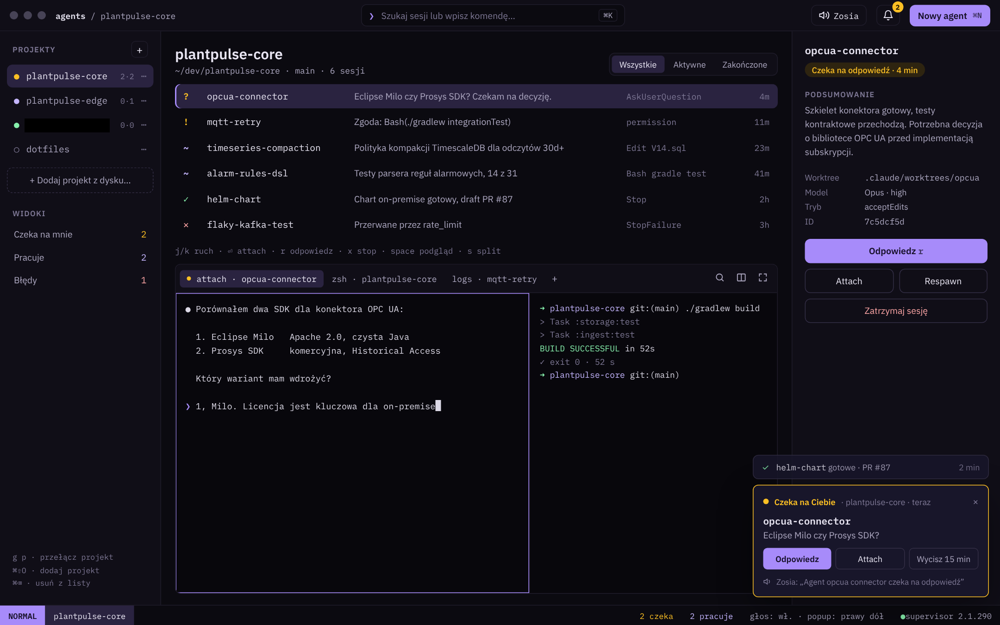

# Agent Manager

Natywna aplikacja na macOS 15 Sequoia+ do zarządzania lokalnymi agentami Claude Code: projekty, sesje, stany, terminal i powiadomienia (popup + głos) w jednym oknie. Kotlin + Compose Desktop, nakładka na supervisor sesji Claude Code.



## Status

Faza koncepcji zakończona, przed implementacją. Postęp: [docs/ROADMAP.md](docs/ROADMAP.md).

## Dokumentacja

Pełny spis w [docs/README.md](docs/README.md). Najważniejsze:

- [Wymagania produktu](docs/02-wymagania.md)
- [Koncepcja techniczna](docs/11-koncepcja-techniczna.md) i [wymagania inżynierskie](docs/10-wymagania-inzynierskie.md)
- [Plan wdrożenia](docs/13-plan-wdrozenia.md)
- [Agent Claude Code tego repo](docs/14-agent-claude-code.md)

## Jak rozwijamy projekt

Repo jest przygotowane do pracy z Claude Code. Zasady są w [CLAUDE.md](CLAUDE.md), subagenci w `.claude/agents/`, skille w `.claude/skills/`, a hooki i uprawnienia w `.claude/settings.json`.

```bash
claude --agent am-lead      # sesja prowadząca: wybiera kolejne zadanie z roadmapy i dowozi je jako PR
/deliver                    # w dowolnej sesji: następne zadanie z roadmapy → branch → testy → kod → PR
/ship                       # commit + push + PR dla bieżących zmian
```

## Wymagania deweloperskie

- macOS 15+, Apple Silicon
- JDK 21 (np. `brew install --cask temurin@21`)
- Claude Code ≥ 2.1.139 (Agent View) i GitHub CLI (`gh auth login`)
