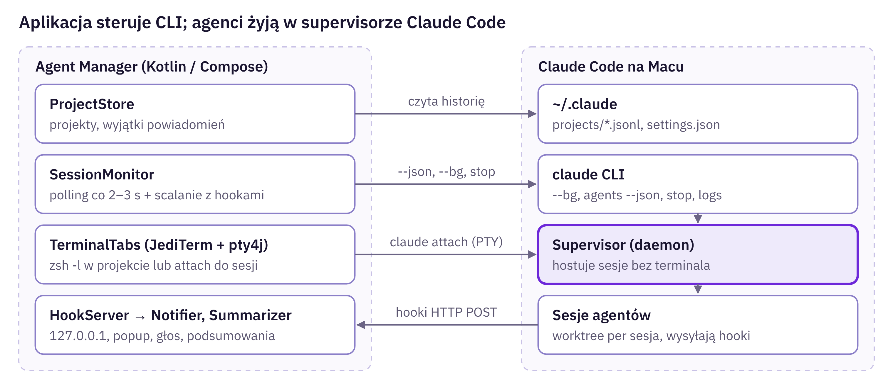
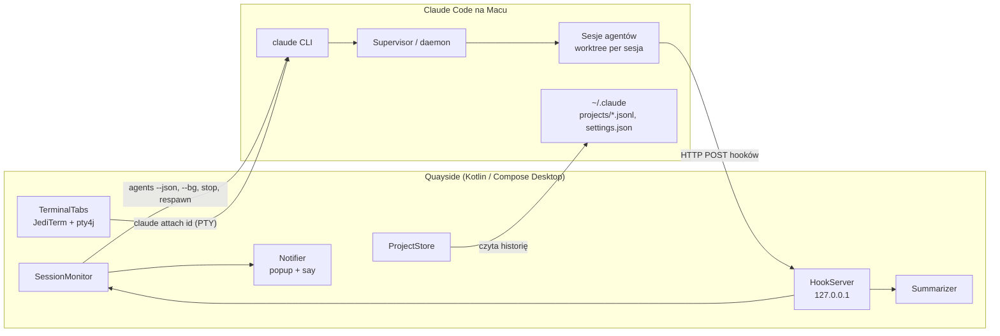

# 03 · Architektura

## Zasada nadrzędna

Aplikacja jest **cienką nakładką GUI** na oficjalny supervisor sesji Claude Code. Nie trzyma procesów agentów. Steruje nimi przez CLI, a o zdarzeniach dowiaduje się z hooków HTTP. Dzięki temu agenci pracują dalej, gdy aplikacja jest zamknięta, po auto-update Claude Code i po uśpieniu Maca.



Ten sam przepływ jako diagram Mermaid, z podziałem na moduły aplikacji:



## Stack technologiczny

| Warstwa | Wybór | Uzasadnienie |
| --- | --- | --- |
| Język | Kotlin (JVM 21) | Znany stack autora, współdzielenie kodu z innymi projektami |
| UI | Compose Multiplatform for Desktop | Deklaratywny UI, motywy przez `CompositionLocal`, okna i tray |
| Terminal | JediTerm + pty4j | Emulator z IDE JetBrains, sprawdzony na macOS; w Compose przez `SwingPanel` |
| HTTP (hooki) | Ktor server (CIO) | Lekki, coroutines, bind tylko do `127.0.0.1` |
| JSON | kotlinx.serialization | Parsowanie `claude agents --json` i payloadów hooków |
| Persystencja | Pliki JSON w `~/Library/Application Support/Quayside/` | Prosto, łatwy eksport motywu |
| Procesy | `ProcessBuilder` przez login shell `/bin/zsh -l -c` | GUI z Findera nie dziedziczy PATH z `.zprofile` |
| Głos | `say -v <głos> -r <tempo>` | Wbudowane w macOS, polski głos Zosia |
| Pakowanie | `jpackage` / Compose `packageDmg`, Developer ID + notaryzacja | Dystrybucja poza App Store |

Alternatywą rozważaną w researchu był natywny SwiftUI + SwiftTerm. Autor wybrał Kotlin.

## Integracja z Claude Code

Wymagana wersja: **Claude Code v2.1.139+** (Agent View, sesje w tle). Agent View jest w research preview, więc całe wywołania CLI siedzą za jednym interfejsem `ClaudeCli`.

| Funkcja aplikacji | Komenda |
| --- | --- |
| Start agenta | `cd <projekt> && claude --bg --name "<nazwa>" [--agent <subagent>] [--model …] [--permission-mode …] "<prompt>"` |
| Lista sesji ze stanem | `claude agents --json --all [--cwd <projekt>]` (polling co 2–3 s) |
| Ostatni output | `claude logs <id>` |
| Interaktywny terminal | `claude attach <id>` w PTY |
| Stop / restart / usunięcie | `claude stop <id>` · `claude respawn <id>` · `claude rm <id>` |
| Zadanie shellowe w tle | `claude --bg --exec '<komenda>'` |
| Stan supervisora | `claude daemon status` |

Pola z `--json`: `id`, `sessionId`, `name`, `cwd`, `kind`, `startedAt`, `state` (`working` / `blocked` / `done` / `failed` / `stopped`), `pid`, `status` (`busy` / `waiting` / `idle`), `waitingFor` (np. `permission prompt`, `input needed`). Dokumentacja odradza parsowanie `~/.claude/jobs/<id>/state.json`, bo to nie jest stabilne API.

### Hooki

Aplikacja przy pierwszym uruchomieniu proponuje dopisanie hooków HTTP do `~/.claude/settings.json` (z backupem) albo do `.claude/settings.local.json` dodanych projektów:

```json
{
  "hooks": {
    "Notification": [{ "hooks": [{ "type": "http", "url": "http://127.0.0.1:47321/hooks", "headers": { "X-AM-Token": "$AM_HOOK_TOKEN" }, "allowedEnvVars": ["AM_HOOK_TOKEN"] }] }],
    "Stop":         [{ "hooks": [{ "type": "http", "url": "http://127.0.0.1:47321/hooks", "headers": { "X-AM-Token": "$AM_HOOK_TOKEN" }, "allowedEnvVars": ["AM_HOOK_TOKEN"] }] }],
    "StopFailure":  [{ "hooks": [{ "type": "http", "url": "http://127.0.0.1:47321/hooks", "headers": { "X-AM-Token": "$AM_HOOK_TOKEN" }, "allowedEnvVars": ["AM_HOOK_TOKEN"] }] }],
    "SessionStart": [{ "hooks": [{ "type": "http", "url": "http://127.0.0.1:47321/hooks", "headers": { "X-AM-Token": "$AM_HOOK_TOKEN" }, "allowedEnvVars": ["AM_HOOK_TOKEN"] }] }],
    "SessionEnd":   [{ "hooks": [{ "type": "http", "url": "http://127.0.0.1:47321/hooks", "headers": { "X-AM-Token": "$AM_HOOK_TOKEN" }, "allowedEnvVars": ["AM_HOOK_TOKEN"] }] }]
  }
}
```

Każde zdarzenie niesie `session_id`, `cwd`, `transcript_path` i `hook_event_name`. `Notification` ma typ (matcher), np. `permission_prompt`, `idle_prompt`, `agent_needs_input`, `agent_completed`. `Stop` zawiera `last_assistant_message`, czyli gotowe źródło podsumowania. `StopFailure` niesie typ błędu, np. `rate_limit` czy `authentication_failed`.

**Zasada scalania:** polling `--json` jest źródłem prawdy o stanie, a hooki dają natychmiastowe zdarzenia i treść (pytanie, podsumowanie). Polling naprawia wszystko, co hooki przegapiły, np. gdy aplikacja była zamknięta.

## Moduły aplikacji

Poniżej logiczne odpowiedzialności. Docelowy podział na moduły Gradle (`agent-runtime`, `projects`, `sessions`, … w układzie `api` / `impl` / `ui`) opisuje [11-koncepcja-techniczna.md](11-koncepcja-techniczna.md).

| Moduł | Odpowiedzialność |
| --- | --- |
| `ClaudeCli` | Jedyne miejsce wywołujące `claude`; wykrywanie wersji i ścieżki binarki przez login shell |
| `ProjectStore` | Lista projektów, dodawanie z walidacją, usuwanie, wyjątki powiadomień per projekt |
| `SessionMonitor` | Polling `agents --json`, scalanie z hookami, `StateFlow<List<Session>>` dla UI |
| `HookServer` | Ktor na `127.0.0.1:47321`, weryfikacja tokenu, publikacja zdarzeń na `SharedFlow` |
| `Summarizer` | Podsumowania z `last_assistant_message`; opcjonalnie `claude -p --model haiku` po każdym `Stop` |
| `Notifier` | Reguły zdarzenie × kanał, popup (okno Compose), głos (`say`), dźwięk, badge w Docku, ciche godziny |
| `TerminalTabs` | Karty i panele JediTerm, profile powłoki, attach do sesji, szukanie |
| `ThemeManager` | Schematy kolorów i typografie, `theme.json`, przełączanie dzień/noc |
| `CommandPalette` | Rejestr komend i skrótów, wyszukiwanie rozmyte |

## Model danych (szkic)

```kotlin
data class Project(val id: String, val path: Path, val displayName: String, val addedAt: Instant,
                   val notifyProfile: NotifyProfile = NotifyProfile.DEFAULT)

enum class SessionState { WORKING, BLOCKED_INPUT, BLOCKED_PERMISSION, DONE, FAILED, STOPPED }

data class Session(val id: String, val sessionId: String?, val name: String, val cwd: Path,
                   val state: SessionState, val waitingFor: String?, val startedAt: Instant,
                   val summary: String?, val lastEvent: HookEvent?, val prUrl: String?)

data class NotifyRule(val event: EventKind, val popup: Boolean, val voice: Boolean,
                      val sound: Boolean, val dockBadge: Boolean)

data class Theme(val scheme: String = "plex", val typography: String = "plex",
                 val uiScale: UiScale = UiScale.M, val density: Density = Density.COMFY,
                 val terminalFontSize: Int = 13, val followSystem: Boolean = true,
                 val dayScheme: String = "paper", val nightScheme: String = "plex")
```

## Pliki konfiguracyjne

| Plik | Zawartość |
| --- | --- |
| `~/Library/Application Support/Quayside/projects.json` | Projekty i wyjątki per projekt |
| `…/notifications.json` | Macierz reguł, ustawienia głosu i popupu, ciche godziny |
| `…/terminal.json` | Profile powłoki, font, skróty |
| `…/theme.json` | Wybrany schemat, typografia, skala, dzień/noc, własne schematy |
| `~/.claude/settings.json` | Hooki HTTP (dopisywane za zgodą, z backupem) |

## Pułapki macOS

- **PATH:** aplikacja uruchomiona z Findera nie widzi `claude`. Wywołania idą przez `/bin/zsh -l -c`, a ścieżka binarki jest zapamiętywana.
- **Bez App Sandbox:** aplikacja uruchamia procesy i czyta `~/.claude`. Dystrybucja przez Developer ID i notaryzację.
- **TCC:** projekty w `~/Documents`, `~/Desktop`, `~/Downloads` wymagają zgody osobno dla aplikacji i dla supervisora Claude Code. Zalecane `~/dev`.
- **Sieć lokalna (macOS 15+):** sesje w tle łączące się z hostami w LAN potrzebują zgody „Local Network”.
- **Autoryzacja supervisora:** błąd `Could not resolve authentication method` naprawia `claude daemon stop --any --keep-workers`, a potem `claude agents`.

## Źródła

- [Claude Code — Manage multiple agents with agent view](https://code.claude.com/docs/en/agent-view)
- [Claude Code — Hooks reference](https://code.claude.com/docs/en/hooks)
- [Claude Code — Headless mode](https://docs.claude.com/en/docs/claude-code/headless)
- [Agent SDK — Sessions](https://code.claude.com/docs/de/agent-sdk/sessions.md)
