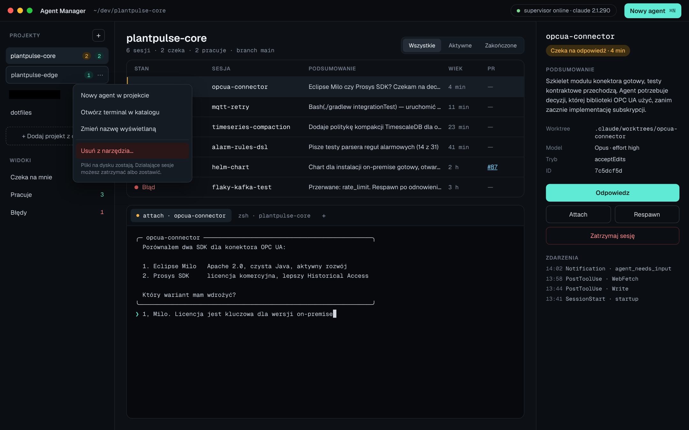
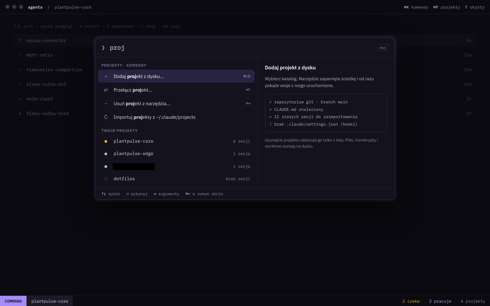
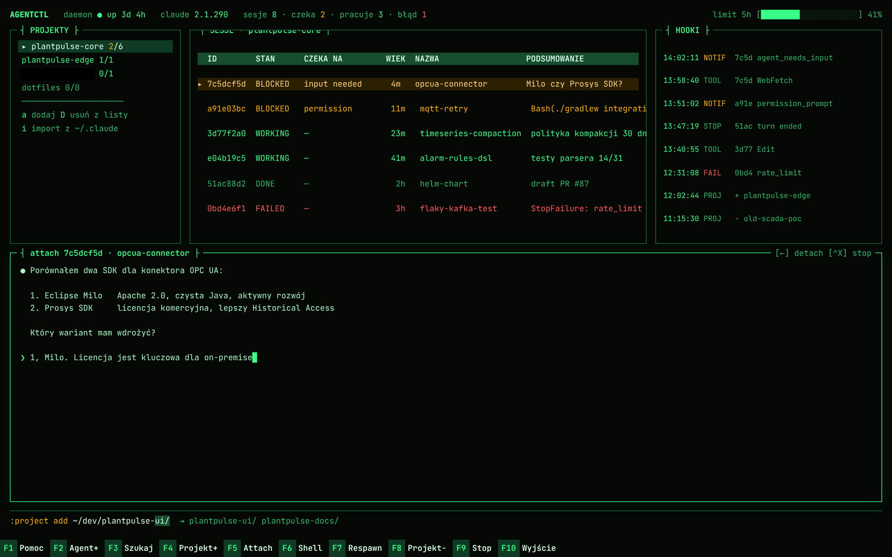
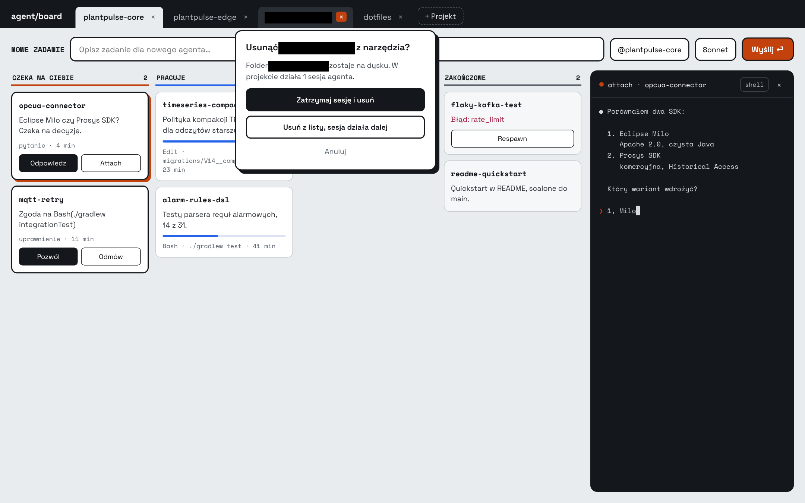
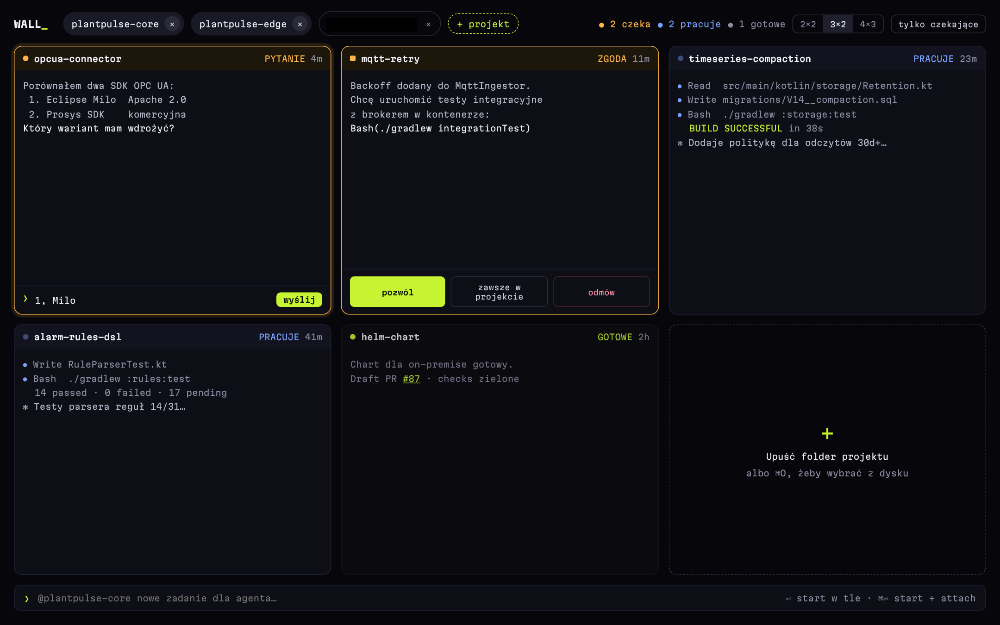

# 04 · Koncepcje UX

Na start powstało 5 różnych kierunków UX. Każdy obsługuje te same funkcje: projekty (dodaj/usuń), sesje, stany, terminal i podsumowanie. Różnią się sposobem pracy.

## 1. Mission Control

Trzy panele: projekty po lewej, tabela sesji z terminalem pod spodem w środku, szczegóły sesji po prawej. Projekt usuwa się z menu kontekstowego „⋯”, a dodaje przyciskiem „+ Dodaj projekt z dysku…”.

## 2. Keyboard-first (paleta komend)

Cała obsługa przez paletę ⌘K i skróty w stylu vima (j/k, a, r, x, dd). Na dole pasek trybu jak w edytorze. Dodawanie projektu ma podgląd z walidacją katalogu.

## 3. TUI / htop

Estetyka terminala: zielony fosfor, panele z ramkami, tabela procesów jak w htop, log hooków na żywo, pasek klawiszy F1–F10 i komenda `:project add` z podpowiadaniem ścieżek.

## 4. Kanban agentów

Jasny motyw, kolumny *Czeka na Ciebie / Pracuje / Do review / Zakończone*. Projekty są zakładkami z „×”. Usuwanie projektu z działającą sesją otwiera dialog z wyborem.

## 5. Ściana terminali

Siatka żywych kafelków (2×2, 3×2, 4×3). Na czekających kafelkach można odpowiedzieć albo dać zgodę bez otwierania terminala. Nowy projekt dodaje się, przeciągając folder na pusty kafelek.

## Decyzja

**Wybrany kierunek: Mission Control w stylu i kolorystyce Keyboard-first.**

> Aktualizacja 2026-10-31 ([ADR 0015](adr/0015-skroty-jako-dodatek.md)): z Keyboard-first bierzemy wygląd, paletę ⌘K i skróty, ale nie jako fundament. Każda akcja ma też widoczną kontrolkę dla myszy, a pasek trybu `NORMAL` staje się paskiem statusu.

| Z koncepcji | Bierzemy |
| --- | --- |
| Mission Control | Układ trzech paneli, panel szczegółów sesji, terminal pod listą |
| Keyboard-first | Paleta ⌘K w nagłówku, kompaktowe wiersze z glifami stanu `? ! ~ ✓ ✕`, skróty j/k jako dodatek, pasek statusu, typografia IBM Plex i fiolet jako domyślny schemat |
| Ściana terminali | Odpowiedź i zgoda bez otwierania terminala, przeniesione do popupu i panelu szczegółów |
| Kanban | Dialog usuwania projektu z działającymi sesjami |
| TUI | Schemat *Phosphor* i typografia JetBrains Mono jako opcje wyglądu |

Specyfikacja wybranego ekranu jest w [05-mission-control.md](05-mission-control.md).
