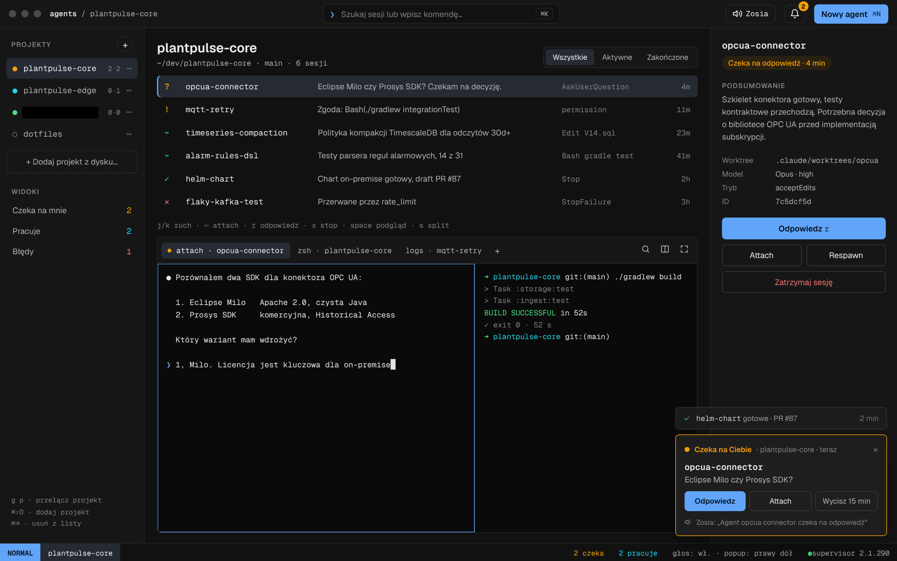
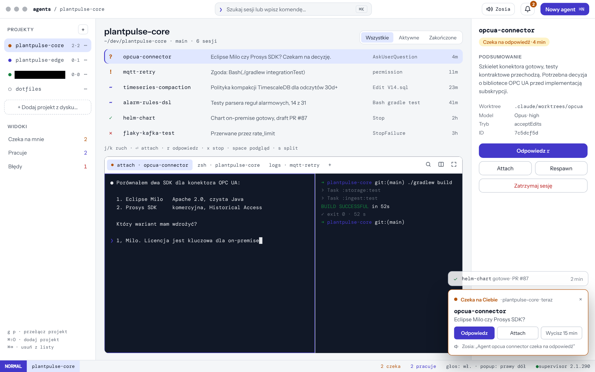
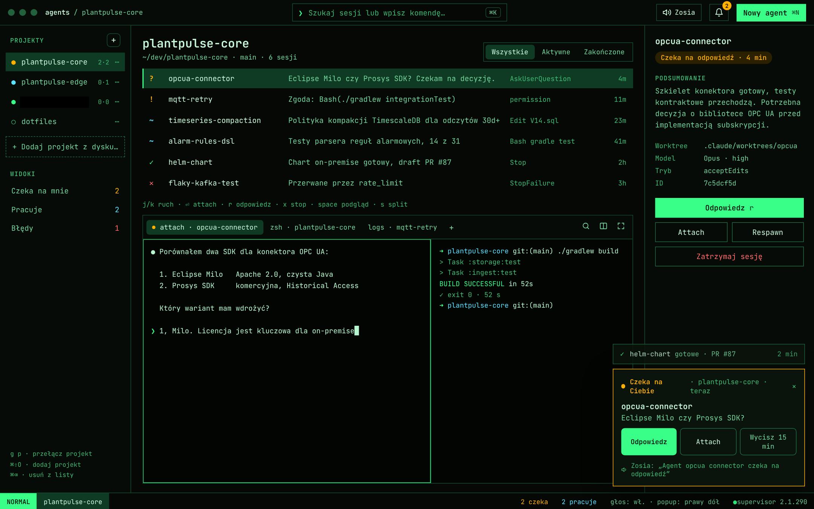
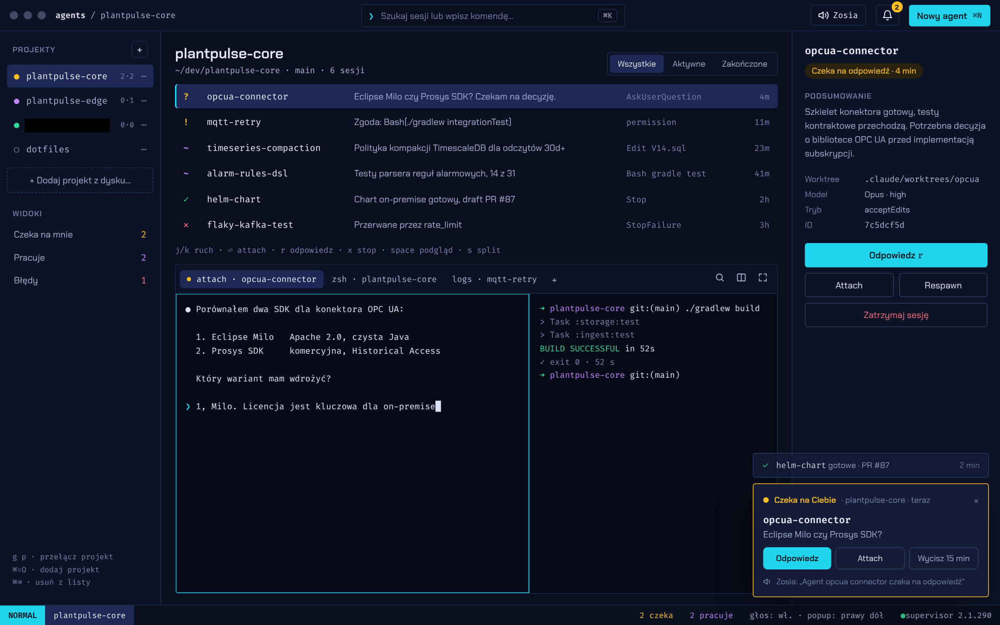
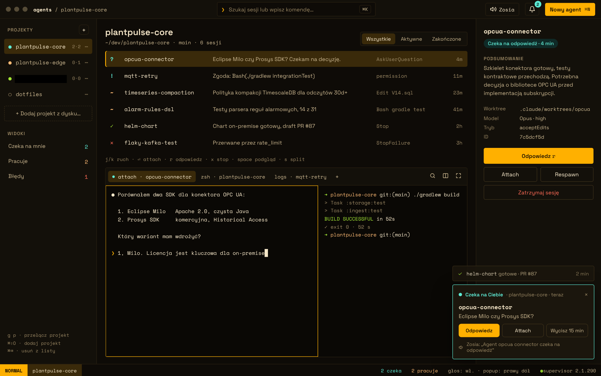
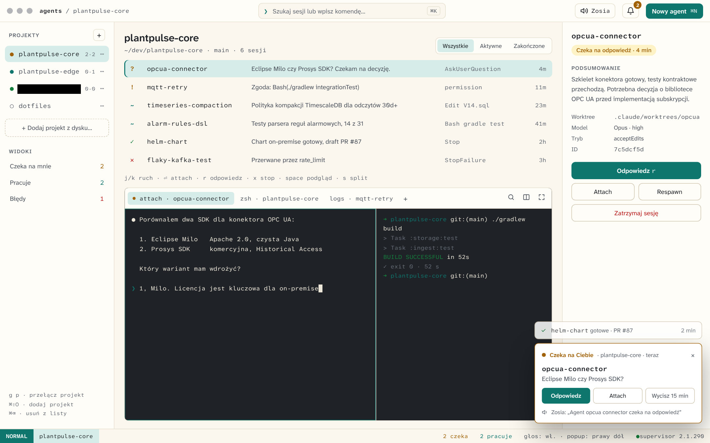
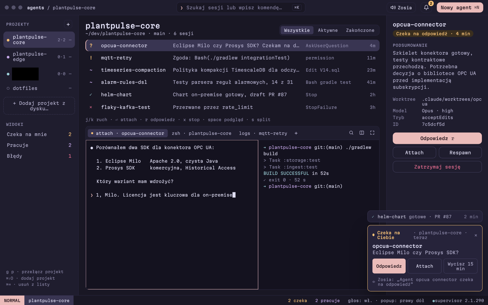
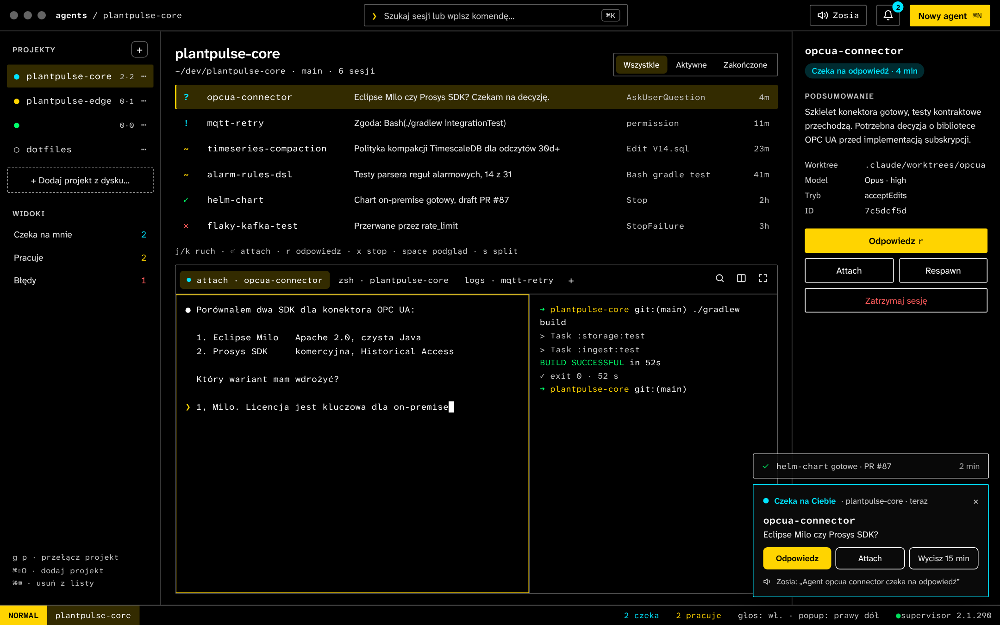

# 05 · Mission Control — specyfikacja głównego ekranu

## Układ

| Strefa | Zawartość |
| --- | --- |
| Nagłówek (44 px) | Ścieżka `agents / <projekt>`, pole palety ⌘K, przełącznik głosu (z nazwą głosu), dzwonek z licznikiem, przycisk **Nowy agent ⌘N** |
| Sidebar projektów (232 px) | Lista projektów z kropką stanu i licznikami `czeka·pracuje`, menu ⋯, przycisk „+ Dodaj projekt z dysku…”, widoki globalne, ściągawka skrótów |
| Środek | Nagłówek projektu (ścieżka, branch, liczba sesji), filtr Wszystkie/Aktywne/Zakończone, lista sesji, linia skrótów, panel terminala |
| Panel szczegółów (300 px) | Nazwa i stan sesji, podsumowanie, worktree/model/tryb/ID, akcje Odpowiedz (r), Attach, Respawn, Zatrzymaj |
| Pasek trybu (28 px) | Tryb `NORMAL`, projekt, liczniki czekających i pracujących, status głosu i popupu, wersja supervisora |
| Popupy | Stos w wybranym rogu ekranu (domyślnie prawy dół); szczegóły w [07](07-powiadomienia.md) |

## Wiersz sesji

`glif · nazwa (mono) · podsumowanie · ostatnie zdarzenie/narzędzie · wiek`. Zaznaczony wiersz ma tło `sel` i pasek akcentu z lewej.

## Stany sesji

| Glif | Stan w UI | Kolor | `state` / `waitingFor` z `--json` | Hook |
| --- | --- | --- | --- | --- |
| `?` | Czeka na odpowiedź | warn | `blocked` / `input needed` | `Notification`: `agent_needs_input`, `idle_prompt` |
| `!` | Prosi o zgodę | warn | `blocked` / `permission prompt` | `Notification`: `permission_prompt` |
| `~` | Pracuje | work | `working` | `UserPromptSubmit`, `PreToolUse` |
| `✓` | Gotowe | ok | `done` | `Stop` (z `last_assistant_message`) |
| `✕` | Błąd | err | `failed` | `StopFailure` (np. `rate_limit`) |
| `○` | Zatrzymana | dim | `stopped` | `SessionEnd` |

## Skróty klawiszowe

| Skrót | Akcja |
| --- | --- |
| ⌘K | Paleta komend |
| ⌘N | Nowy agent w bieżącym projekcie |
| ⌘⇧O / ⌘⌫ | Dodaj projekt / usuń projekt z narzędzia |
| g p | Przełącz projekt |
| j / k | Następna / poprzednia sesja |
| ⏎ | Attach w terminalu |
| r | Odpowiedz wybranej sesji |
| x | Zatrzymaj sesję |
| space | Podgląd ostatniego outputu |
| s | Podziel terminal |
| ⌘, | Ustawienia |

## Warianty wyglądu

Ten sam ekran działa z każdym schematem kolorów i każdą typografią (szczegóły w [08](08-wyglad.md)). Wszystkie 9 schematów, każdy z przykładową typografią:

| | |
| --- | --- |
|  **Plex Violet** · IBM Plex |  **Graphite** · Geist |
|  **Paper Indigo** · Instrument Sans + DM Mono |  **Phosphor** · JetBrains Mono |
|  **Synth** · Chakra Petch + Fira Code |  **Amber CRT** · Space Grotesk + Space Mono |
|  **Sand** · Atkinson Hyperlegible |  **Rose Night** · Martian Mono |
|  **Wysoki kontrast** · Atkinson Hyperlegible | |
