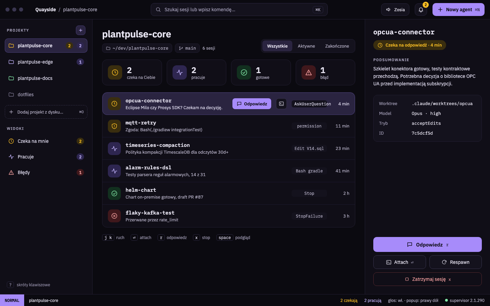

# 05 · Mission Control — specyfikacja głównego ekranu

## Układ

| Strefa | Zawartość |
| --- | --- |
| Górny pasek okna | Pod natywnym paskiem tytułu macOS, nad oboma układami (lista i tryb terminala). Okruszki „Quayside / projekt” (w widoku globalnym nazwa widoku, w trybie terminala dochodzi nazwa sesji aktywnej karty), pole „Szukaj sesji lub wpisz komendę…” z ⌘K (klik otwiera paletę; to przycisk, nie pole tekstowe), chip głosu z nazwą głosu („Głos systemowy”, „Głos wył.”; klik otwiera ustawienia powiadomień), dzwonek z liczbą sesji widoku „Czeka na mnie” (klik pokazuje ten widok, w trybie terminala wraca do listy), przycisk **Nowy agent ⌘N** przy prawej krawędzi. Żaden element paska nie bierze fokusu |
| Sidebar projektów (260 dp) | Nagłówek „PROJEKTY” z przyciskiem „+” (dodaje projekt), lista projektów z ikoną folderu w tonie projektu i okrągłymi licznikami czekających i pracujących, menu ⋯ (Zmień nazwę, Podfoldery projektu…, Usuń), projekt z podfolderami (grupa, FR-P7) ma strzałkę zwijania „Zwiń/Rozwiń grupę” i pod wierszem wiersze podfolderów z wcięciem, małą ikoną folderu i własnymi licznikami (kliknięcie zawęża Mission Control do podfolderu; wiersz projektu liczy wszystkie sesje projektu), pod listą przerywany przycisk „Dodaj projekt z dysku…” z prawdziwym skrótem (`⇧⌘O`), etykieta „WIDOKI” i widoki globalne z ikoną i okrągłym licznikiem, na dole zwijana ściągawka „? skróty klawiszowe”. Zaznaczony projekt lub widok ma tło `sel` i ramkę `accent` z promieniem wiersza |
| Środek | Nagłówek projektu w dwóch wierszach (tytuł, dla podfolderu „projekt / podfolder” ze ścieżką i liczbą sesji podfolderu; pod nim pigułka ścieżki, liczba sesji i po prawej segmenty Wszystkie/Aktywne/Zakończone), cztery kafelki liczników (czeka, pracuje, gotowe, błąd; zatrzymane nie są liczone), na stronie grupy (bez wybranego podfolderu) sekcja „Podfoldery”: karta do ok. 4,5 wiersza z przewijaniem, w wierszu podfolderu ikona folderu, nazwa i liczniki czekających, z błędem i pracujących (zera ukryte, bez nich „brak agentów”); wiersze idą poziomami czeka, błąd, pracuje, reszta (w poziomie alfabetycznie bez wielkości liter), na końcu nieklikalne „Pozostałe” (sesje poza podfolderami), jeśli coś tam czeka, pracuje albo ma błąd; kliknięcie wiersza zaznacza podfolder w sidebarze (zwinięta grupa się rozwija) i otwiera jego stronę, wiersze nie biorą fokusu; liczby nie zależą od segmentów Wszystkie/Aktywne/Zakończone, lista sesji jako jedna karta z separatorami (prawy klik lub ⋯ w wierszu otwiera menu akcji), pod nią pasek podpowiedzi (`j k` ruch, `⏎` attach, `r` odpowiedz, `x` stop, `space` podgląd; teksty klawiszy z `AppShortcuts`), panel terminala. Pasek podpowiedzi nie dotyczy trybu terminala: Esc należy tam do Claude Code |
| Panel szczegółów (340 dp) | Nazwa (mono, 15 sp), pigułka stanu („Czeka na odpowiedź · 4 min”), PODSUMOWANIE, pola klucz–wartość w dwóch kolumnach w ramce (worktree: ścieżka względna do katalogu projektu, gdy leży pod nim, inaczej pełna; ID; start; ostatnia aktywność; model, tryb i gałąź git dojdą w AM-818), na dole przyciski: główna Odpowiedz (r), zwykłe Attach (⏎), Respawn i Podgląd, groźne osobno Zatrzymaj (x) i Usuń z listy |
| Pasek stanu | Dół okna w obu układach. Plakietka `NORMAL` albo `TERMINAL`, projekt (poza widokiem globalnym), „N czekają” (warn), „M pracują” (work), status powiadomień („głos: wł. · popup: prawy dół”), kropka świeżości migawki (ok, err, muted) i „supervisor 2.1.150” (wersja z `claude --version`, czytana raz przy starcie okna; bez Claude Code zamiast niej tekst świeżości) |
| Popupy | Stos w wybranym rogu ekranu (domyślnie prawy dół); szczegóły w [07](07-powiadomienia.md) |

## Wiersz sesji

`kafelek stanu 38 dp · nazwa (mono) nad podsumowaniem · pigułka ostatniego zdarzenia/narzędzia · wiek`. W gęstości **Kompaktowej** (ustawienie Wyglądu, docs/08) wiersz ma kafelek 28 dp, odstęp pionowy 4 dp i jedną linię: podsumowanie jest wtedy tylko w panelu szczegółów, a stan nadal widać w kafelku i pigułce (nie tylko kolorem). Zaznaczony wiersz ma tło `sel` oraz przyciski Odpowiedz (gdy sesja czeka) i Attach (przycisk ikonowy); „⋯” otwiera menu akcji.

## Stany sesji

| Glif | Stan w UI | Kolor | `state` / `waitingFor` z `--json` | Hook |
| --- | --- | --- | --- | --- |
| `?` | Czeka na odpowiedź | warn | `blocked` / `input needed` | `Notification`: `agent_needs_input`, `idle_prompt` |
| `!` | Prosi o zgodę | warn | `blocked` / `permission prompt` | `Notification`: `permission_prompt` |
| `~` | Pracuje | work | `working` | `UserPromptSubmit`, `PreToolUse` |
| `✓` | Gotowe | ok | `done` | `Stop` (z `last_assistant_message`) |
| `✕` | Błąd | err | `failed` | `StopFailure` (np. `rate_limit`) |
| `○` | Zatrzymana | dim | `stopped` | `SessionEnd` |

## Mysz

Każdą akcję da się wykonać bez klawiatury ([ADR 0015](adr/0015-skroty-jako-dodatek.md)):

| Gest | Akcja |
| --- | --- |
| Klik w wiersz | Zaznaczenie i panel szczegółów |
| Dwuklik w wiersz | Attach w terminalu |
| Prawy klik lub ⋯ w wierszu | Menu: Odpowiedz, Attach, Podgląd, Respawn, Zatrzymaj, Usuń |
| Przyciski w panelu szczegółów | Odpowiedz, Attach, Respawn, Zatrzymaj |
| Pole palety w nagłówku | Paleta komend (to samo co ⌘K) |

## Skróty klawiszowe

Skróty są przyspieszeniem dla wprawionych; każdy ma odpowiednik w menu albo palecie.

| Skrót | Akcja |
| --- | --- |
| ⌘K | Paleta komend |
| ⌘N | Nowy agent w bieżącym projekcie |
| ⌘⇧O / ⌘⌫ | Dodaj projekt / usuń projekt z narzędzia |
| g p | Przełącz projekt |
| j / k | Następna / poprzednia sesja |
| ⏎ | Attach w terminalu |
| r | Odpowiedz wybranej sesji |
| x | Zatrzymaj sesję |
| space | Podgląd ostatniego outputu |
| s | Podziel terminal |
| ⌘, | Ustawienia |

## Warianty wyglądu

Ten sam ekran działa z każdym schematem kolorów i każdą typografią. Dostępne motywy opisuje [08](08-wyglad.md) oraz [Quayside Themes Documentation.md](Quayside%20Themes%20Documentation.md).
