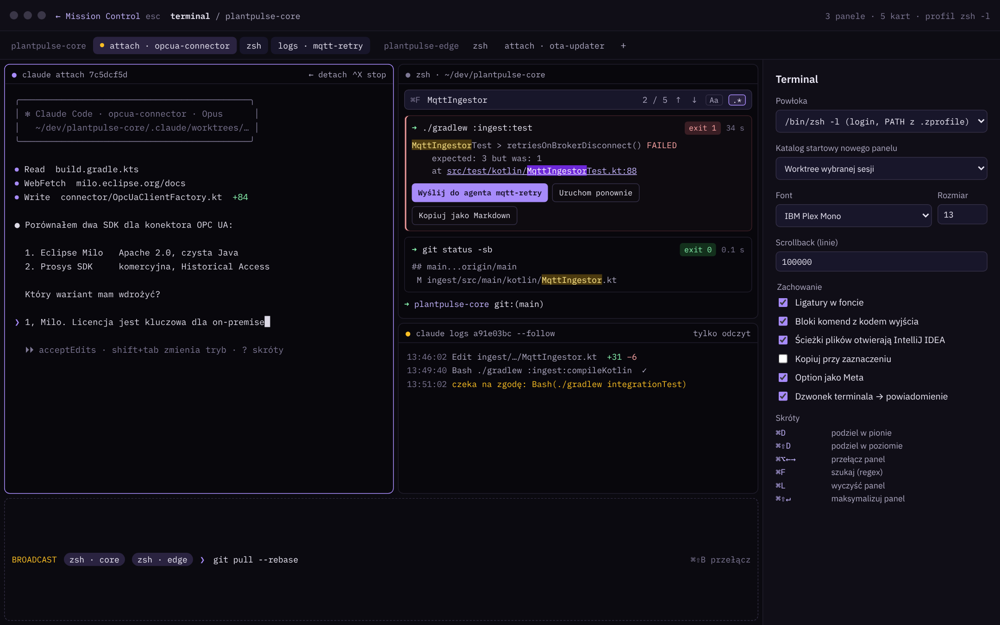

# 06 · Terminal

Terminal jest pełnoprawną częścią aplikacji, nie dodatkiem. Działa w dwóch miejscach: jako panel pod listą sesji w Mission Control i jako pełnoekranowy **tryb terminala** (przycisk pełnego ekranu, bez skrótu klawiszowego). Skrót ⌘⇧↵ maksymalizuje aktywny panel w obrębie panelu terminala, a ten sam skrót przywraca układ.

## Funkcje

| Funkcja | Opis |
| --- | --- |
| Karty per projekt | Karty pogrupowane nazwą projektu; kropka stanu przy karcie `attach` |
| Rodzaje kart | `attach · <sesja>` (`claude attach <id>`), `zsh` (login shell w katalogu projektu lub worktree), `logs · <sesja>` (`claude logs <id> --follow`, tylko odczyt) |
| Panele | Podział na dwa panele obok siebie ⌘D i jeden pod drugim ⌘⇧D (najwyżej 4, bez przeciągania granic), przełączanie ⌘⌥←→, maksymalizacja aktywnego panelu ⌘⇧↵ (ten sam skrót przywraca układ); aktywny panel ma ramkę w kolorze akcentu |
| Szukanie | ⌘F otwiera pasek w prawym górnym rogu aktywnego panelu (ponowne ⌘F zaznacza tekst w polu); wszystkie trafienia w historii i na ekranie są podświetlone, bieżące mocniej; licznik `3/12`, przełączniki *Aa* (wielkość liter) i `.*` (regex, składnia Javy); ⏎ i ↑ idą do starszego trafienia, ⇧⏎ i ↓ do nowszego (cyklicznie); Esc zamyka pasek, czyści podświetlenia i oddaje fokus terminalowi |
| Bloki komend | Każda komenda w shellu jako blok z kodem wyjścia i czasem; akcje *Uruchom ponownie*, *Kopiuj jako Markdown*, **Wyślij do agenta** (przekazuje output błędu do wybranej sesji) |
| Linki | `plik.kt:88` i URL-e klikalne; pliki otwierają się w IntelliJ IDEA |
| Broadcast | Jedna komenda do kilku zaznaczonych paneli (⌘⇧B), np. `git pull --rebase` w dwóch projektach |
| Detach / stop | W karcie attach: ← detach (sesja dalej działa), ^X stop |

## Ustawienia terminala

| Ustawienie | Domyślnie |
| --- | --- |
| Powłoka | `/bin/zsh -l` (login, PATH z `.zprofile`); do wyboru bash, fish |
| Katalog startowy nowego panelu | Worktree wybranej sesji (alternatywnie katalog projektu lub domowy) |
| Font i rozmiar | Z typografii (np. IBM Plex Mono), 13 px |
| Scrollback | 100 000 linii |
| Ligatury | Włączone |
| Bloki komend z kodem wyjścia | Włączone |
| Ścieżki otwierają IntelliJ IDEA | Włączone |
| Kopiuj przy zaznaczeniu | Wyłączone |
| Option jako Meta | Włączone |
| Dzwonek terminala → powiadomienie | Włączone |

## Implementacja

- **JediTerm + pty4j** osadzone w Compose przez `SwingPanel`. Każdy panel to osobny `TtyConnector` z procesem PTY.
- Bloki komend wymagają integracji z powłoką: znaczniki OSC 133 (prompt start/end, command start/end, exit code) wstrzykiwane przez krótki skrypt w `ZDOTDIR` aplikacji. Do sprawdzenia, ile JediTerm obsługuje natywnie.
- „Wyślij do agenta”: tekst bloku trafia do sesji jako odpowiedź (attach i wpisanie albo kolejka wiadomości), z prefiksem „Output z terminala:”.
- Kolory terminala (16 ANSI + tło i tekst) pochodzą z aktywnego schematu (`termBg`, `termText`, `ok`, `err`, `warn`, `work`, `accent`).
