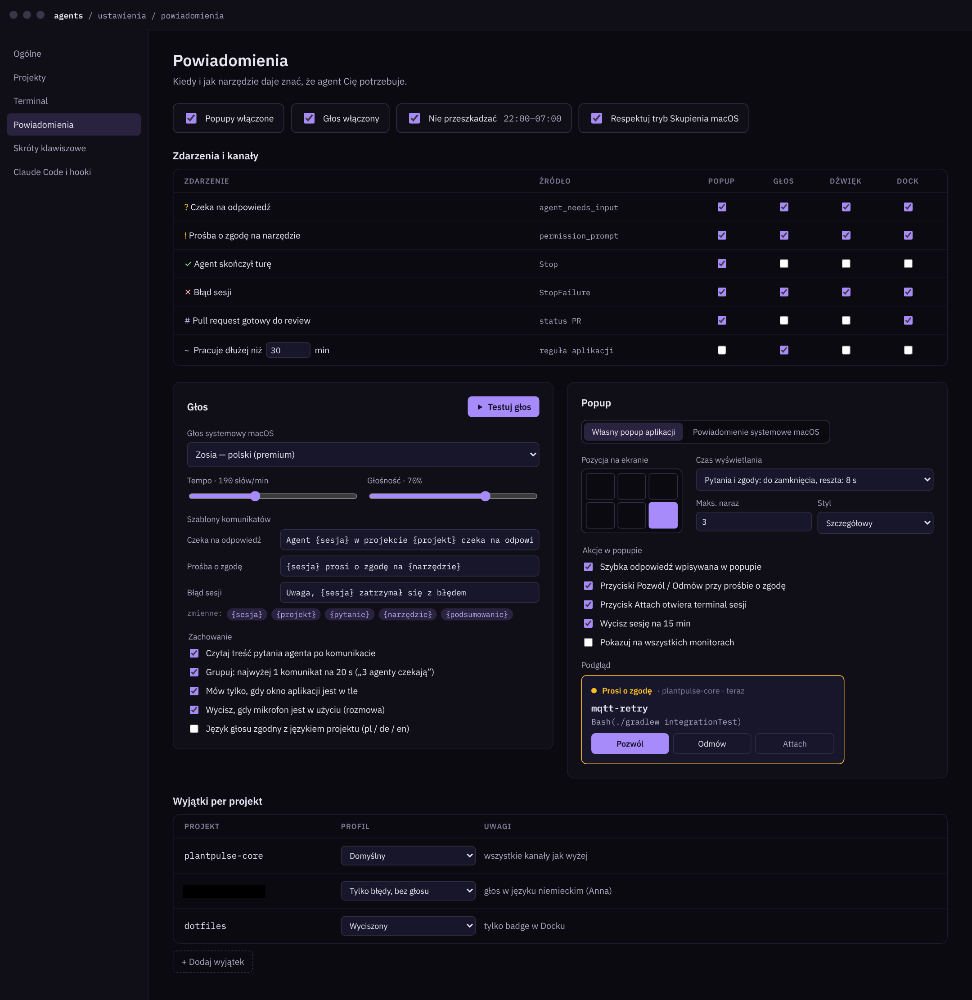

# 07 · Powiadomienia

Powiadomienia mają jeden cel: gdy agent czeka, użytkownik ma się o tym dowiedzieć w ciągu 2 sekund i móc zareagować bez szukania okna.

## Zdarzenia i kanały (ustawienia domyślne)

| Zdarzenie | Źródło | Popup | Głos | Dźwięk | Dock |
| --- | --- | :-: | :-: | :-: | :-: |
| `?` Czeka na odpowiedź | `Notification: agent_needs_input` | ✓ | ✓ | ✓ | ✓ |
| `!` Prośba o zgodę na narzędzie | `Notification: permission_prompt` | ✓ | ✓ | ✓ | ✓ |
| `✓` Agent skończył turę | `Stop` | ✓ | – | – | – |
| `✕` Błąd sesji | `StopFailure` | ✓ | ✓ | ✓ | ✓ |
| `#` Pull request gotowy do review | status PR z `agents --json` | ✓ | – | – | ✓ |
| `~` Pracuje dłużej niż N min (domyślnie 30) | reguła aplikacji | – | ✓ | – | – |
| `🔔` Dzwonek terminala (BEL) | terminal; przełącznik w ustawieniach terminala | ✓ | – | – | – |

Globalne przełączniki: popupy, głos, **Nie przeszkadzać** w godzinach (domyślnie 22:00–07:00), respektowanie trybu Skupienia macOS.

## Popup

| Ustawienie | Opcje (domyślne pogrubione) |
| --- | --- |
| Rodzaj | **Własny popup aplikacji** / powiadomienie systemowe macOS |
| Pozycja | 6 miejsc: górny i dolny rząd × lewo, środek, prawo (**prawy dół**) |
| Czas wyświetlania | **Pytania i zgody do zamknięcia, reszta 8 s** / zawsze 8 s / zawsze do zamknięcia |
| Maks. naraz | **3**, starsze zwijają się do kompaktowej linii |
| Styl | **Szczegółowy** / kompaktowy |
| Akcje | Szybka odpowiedź w popupie, Pozwól/Odmów, Attach, Wycisz sesję na 15 min |
| Monitory | Tylko aktywny (domyślnie) / wszystkie |

Wygląd popupu: kolorowy pasek stanu, nazwa projektu i czas, nazwa sesji (mono), treść pytania lub narzędzia, przyciski akcji, a pod spodem podpis, co powiedział głos.

**Implementacja:** osobne okno Compose (`Window(undecorated = true, alwaysOnTop = true, transparent = true)`), pozycjonowane względem `GraphicsEnvironment` aktywnego ekranu. Wersja systemowa przez `UNUserNotificationCenter` wymaga natywnego mostu (JNA/JNI) albo pomocniczego helpera w Swift. Na MVP wystarczy własny popup.

## Głos

| Ustawienie | Domyślnie |
| --- | --- |
| Głos systemowy | Zosia (polski, premium); także Anna (de), Samantha (en) |
| Tempo | 190 słów/min |
| Głośność | 70% |
| Szablon „czeka na odpowiedź” | `Agent {sesja} w projekcie {projekt} czeka na odpowiedź` |
| Szablon „prośba o zgodę” | `{sesja} prosi o zgodę na {narzędzie}` |
| Szablon „błąd” | `Uwaga, {sesja} zatrzymał się z błędem` |
| Zmienne | `{sesja}`, `{projekt}`, `{pytanie}`, `{narzędzie}`, `{podsumowanie}` |
| Czytaj treść pytania po komunikacie | Włączone |
| Grupowanie | Najwyżej 1 komunikat na 20 s, kolejne łączone („3 agenty czekają”) |
| Mów tylko, gdy okno aplikacji jest w tle | Włączone |
| Wycisz przy aktywnym mikrofonie | Włączone |
| Język głosu wg języka projektu | Wyłączone |

**Implementacja:** `say -v Zosia -r 190 "<tekst>"` uruchamiane przez `ProcessBuilder`, z kolejką i deduplikacją. Myślniki w nazwach sesji zamieniane na spacje („opcua connector”). Głośność przez `[[volm 0.7]]` w tekście albo osobny mikser. Wykrycie aktywnego mikrofonu przez CoreAudio (`kAudioDevicePropertyDeviceIsRunningSomewhere`) przez JNA.

## Wyjątki per projekt

| Projekt (przykład) | Profil | Uwagi |
| --- | --- | --- |
| plantpulse-core | Domyślny | wszystkie kanały jak wyżej |
| plantpulse-docs | Tylko błędy, bez głosu | głos po niemiecku (Anna) |
| dotfiles | Wyciszony | tylko badge w Docku |
