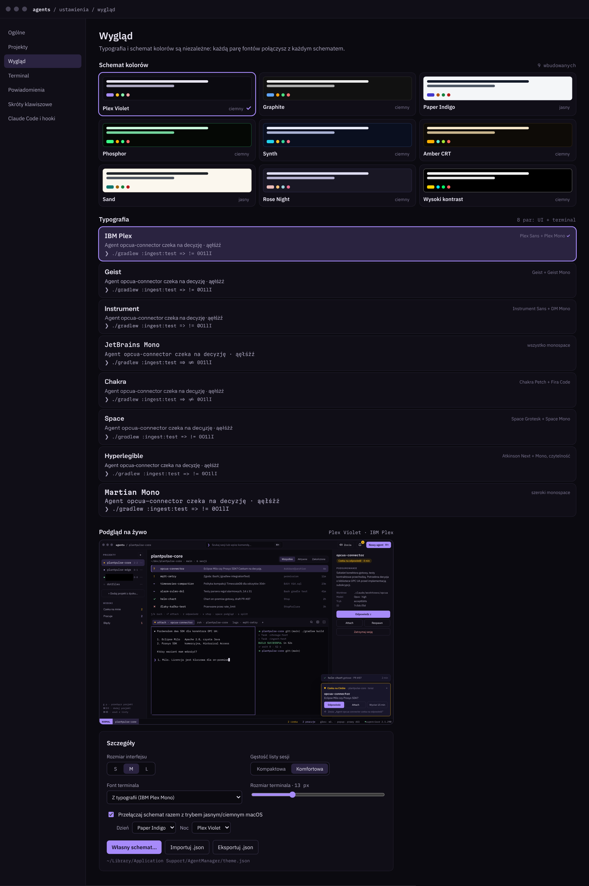

# 08 · Wygląd: schematy kolorów i typografia

Schemat kolorów i typografia są **niezależne**: każdą z 8 typografii można połączyć z każdym z 9 schematów (72 kombinacje). Wybór odbywa się w *Ustawienia → Wygląd*, z podglądem prawdziwego ekranu Mission Control na żywo.



## Schematy kolorów

| Klucz | Nazwa | Tryb | bg | panel | text | accent | warn | ok | err | work | promień |
| --- | --- | --- | --- | --- | --- | --- | --- | --- | --- | --- | --- |
| `plex` | Plex Violet (domyślny) | ciemny | `#0B0A10` | `#100E17` | `#E8E5F2` | `#A78BFA` | `#FBBF24` | `#86EFAC` | `#FCA5A5` | `#C4B5FD` | 8 px |
| `graphite` | Graphite | ciemny | `#111111` | `#161616` | `#EDEDED` | `#60A5FA` | `#F59E0B` | `#4ADE80` | `#F87171` | `#22D3EE` | 6 px |
| `paper` | Paper Indigo | jasny | `#F4F6F8` | `#FFFFFF` | `#111827` | `#4338CA` | `#B45309` | `#15803D` | `#B91C1C` | `#4338CA` | 10 px |
| `phosphor` | Phosphor | ciemny | `#050805` | `#070B07` | `#C8F7DB` | `#39FF88` | `#FFB000` | `#39FF88` | `#FF6B66` | `#5CE1FF` | 0 px |
| `synth` | Synth | ciemny | `#0A0F1F` | `#0D1326` | `#E6EAF7` | `#22D3EE` | `#FBBF24` | `#34D399` | `#FB7185` | `#C084FC` | 4 px |
| `amber` | Amber CRT | ciemny | `#0E0B07` | `#13100A` | `#F5E6C8` | `#FFB000` | `#5EEAD4` | `#A3E635` | `#FF6B57` | `#FDBA74` | 4 px |
| `sand` | Sand | jasny | `#FBF7EE` | `#FFFDF8` | `#1F2328` | `#0F766E` | `#A16207` | `#15803D` | `#B91C1C` | `#0F766E` | 8 px |
| `rose` | Rose Night | ciemny | `#191724` | `#1F1D2E` | `#E0DEF4` | `#EBBCBA` | `#F6C177` | `#9CCFD8` | `#EB6F92` | `#C4A7E7` | 10 px |
| `contrast` | Wysoki kontrast | ciemny | `#000000` | `#000000` | `#FFFFFF` | `#FFD400` | `#00E5FF` | `#00FF6A` | `#FF5C5C` | `#FFD400` | 2 px |

Pełny zestaw tokenów w każdym schemacie: `bg`, `panel`, `raised`, `sel`, `border`, `border2`, `text`, `muted`, `dim`, `accent`, `accentInk`, `warn`, `warnInk`, `warnBg`, `ok`, `err`, `work`, `termBg`, `termText`, `radius`. W jasnych schematach terminal zostaje ciemny (`termBg` grafitowy).

**Semantyka kolorów:** `warn` = agent czeka na Ciebie (najważniejszy sygnał w UI), `work` = pracuje, `ok` = gotowe, `err` = błąd, `accent` = akcje główne i zaznaczenie. W schemacie *Amber CRT* akcent jest bursztynowy, więc `warn` jest turkusowy, żeby oba się nie myliły.

## Typografie

| Klucz | Nazwa | Font UI | Font terminala | Charakter |
| --- | --- | --- | --- | --- |
| `plex` | IBM Plex (domyślna) | IBM Plex Sans | IBM Plex Mono | techniczna, neutralna |
| `geist` | Geist | Geist | Geist Mono | nowoczesna, zwarta |
| `instrument` | Instrument | Instrument Sans | DM Mono | miękka, „produktowa” |
| `jetbrains` | JetBrains Mono | JetBrains Mono | JetBrains Mono | wszystko monospace, ligatury |
| `chakra` | Chakra | Chakra Petch | Fira Code | kanciasta, „sci-fi” |
| `space` | Space | Space Grotesk | Space Mono | ekspresyjna, retro |
| `hyper` | Hyperlegible | Atkinson Hyperlegible Next | Atkinson Hyperlegible Mono | maksymalna czytelność |
| `martian` | Martian Mono | Martian Mono | Martian Mono | szeroki monospace |

Wszystkie fonty są na licencji SIL Open Font License i można je dołączyć do aplikacji (folder `resources/fonts`, ładowane przez `Font(resource = …)` w Compose). Każda typografia jest sprawdzana na polskich znakach (`ąęłśżź`) i znakach łatwych do pomylenia w kodzie (`0O1lI`, `=>`, `!=`).

## Pozostałe ustawienia wyglądu

| Ustawienie | Opcje |
| --- | --- |
| Rozmiar interfejsu | S / **M** / L (skala `Density` w Compose) |
| Gęstość listy sesji | Kompaktowa / **Komfortowa** |
| Font terminala | Z typografii albo własny |
| Rozmiar terminala | 10–20 px, domyślnie 13 |
| Dzień / noc | Przełączanie razem z trybem macOS; osobny schemat na dzień (np. Paper Indigo) i na noc (np. Plex Violet) |
| Własne motywy | Własny schemat, import i eksport `.json` |

## `theme.json`

```json
{
  "scheme": "plex",
  "typography": "plex",
  "uiScale": "M",
  "density": "comfy",
  "terminal": { "font": "auto", "size": 13 },
  "followSystem": true,
  "dayScheme": "paper",
  "nightScheme": "plex",
  "customSchemes": {}
}
```

Plik leży w `~/Library/Application Support/AgentManager/theme.json`. W Kotlinie mapuje się 1:1 na `data class Theme` z kotlinx.serialization, a schematy na `data class ColorScheme(val bg: Color, …)` dostarczane przez `CompositionLocalProvider`.
