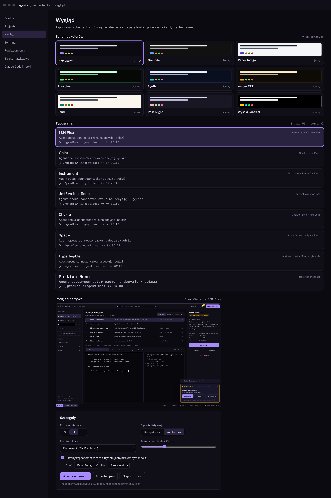

# 08 · Wygląd: motywy, schematy kolorów i typografia

Terminy w tym dokumencie:

- **schemat kolorów** — zestaw tokenów kolorów (`bg`, `text`, `warn` …);
- **motyw** — schemat kolorów + tokeny kształtu (promień, grubość ramki, cień, tło panelu) + opcjonalnie domyślna typografia, którą ustawienia tylko podpowiadają;
- **typografia** — para fontów: font UI i font terminala.

Katalog ma **29 motywów**: 9 podstawowych (sekcja „Schematy kolorów”) i 20 motywów z kształtem (sekcja „Motywy z kształtem”). Jasnych jest 12, ciemnych 17, w tym 2 motywy wysokiego kontrastu (`contrast` ciemny, `hc-light` jasny). Motyw i typografia są **niezależne**: każdą z 22 typografii można połączyć z każdym z 29 motywów (638 kombinacji). Wybór odbywa się w *Ustawienia → Wygląd*, z podglądem prawdziwego ekranu Mission Control na żywo.



## Schematy kolorów (9 podstawowych motywów)

| Klucz | Nazwa | Tryb | bg | panel | text | accent | warn | ok | err | work | promień |
| --- | --- | --- | --- | --- | --- | --- | --- | --- | --- | --- | --- |
| `plex` | Plex Violet (domyślny) | ciemny | `#0B0A10` | `#100E17` | `#E8E5F2` | `#A78BFA` | `#FBBF24` | `#86EFAC` | `#FCA5A5` | `#C4B5FD` | 8 px |
| `graphite` | Graphite | ciemny | `#111111` | `#161616` | `#EDEDED` | `#60A5FA` | `#F59E0B` | `#4ADE80` | `#F87171` | `#22D3EE` | 6 px |
| `paper` | Paper Indigo | jasny | `#F4F6F8` | `#FFFFFF` | `#111827` | `#4338CA` | `#B45309` | `#15803D` | `#B91C1C` | `#4338CA` | 10 px |
| `phosphor` | Phosphor | ciemny | `#050805` | `#070B07` | `#C8F7DB` | `#39FF88` | `#FFB000` | `#39FF88` | `#FF6B66` | `#5CE1FF` | 0 px |
| `synth` | Synth | ciemny | `#0A0F1F` | `#0D1326` | `#E6EAF7` | `#22D3EE` | `#FBBF24` | `#34D399` | `#FB7185` | `#C084FC` | 4 px |
| `amber` | Amber CRT | ciemny | `#0E0B07` | `#13100A` | `#F5E6C8` | `#FFB000` | `#5EEAD4` | `#A3E635` | `#FF6B57` | `#FDBA74` | 4 px |
| `sand` | Sand | jasny | `#FBF7EE` | `#FFFDF8` | `#1F2328` | `#0F766E` | `#A16207` | `#15803D` | `#B91C1C` | `#0F766E` | 8 px |
| `rose` | Rose Night | ciemny | `#191724` | `#1F1D2E` | `#E0DEF4` | `#EBBCBA` | `#F6C177` | `#9CCFD8` | `#EB6F92` | `#C4A7E7` | 10 px |
| `contrast` | Wysoki kontrast | ciemny | `#000000` | `#000000` | `#FFFFFF` | `#FFD400` | `#00E5FF` | `#00FF6A` | `#FF5C5C` | `#FFD400` | 2 px |

Pełny zestaw tokenów kolorów w każdym motywie (także w 20 motywach z kształtem, po wyprowadzeniu brakujących): `bg`, `panel`, `raised`, `sel`, `border`, `border2`, `text`, `muted`, `dim`, `accent`, `accentInk`, `warn`, `warnInk`, `warnBg`, `ok`, `err`, `work`, `termBg`, `termText`. Tokeny kształtu: `radius`, `borderWidth`, `shadow`, `backdrop`. W jasnych motywach terminal zostaje ciemny (`termBg` grafitowy).

**Semantyka kolorów:** `warn` = agent czeka na Ciebie (najważniejszy sygnał w UI), `work` = pracuje, `ok` = gotowe, `err` = błąd, `accent` = akcje główne i zaznaczenie. W schemacie *Amber CRT* akcent jest bursztynowy, więc `warn` jest turkusowy, żeby oba się nie myliły.

Kształt 9 podstawowych motywów: `radius` z tabeli, `borderWidth` 1 px, brak cienia, panel nieprzezroczysty, bez domyślnej typografii (propozycja; ustala AM-801).

## Typografie

Typografie podstawowe (8):

| Klucz | Nazwa | Font UI | Font terminala | Charakter |
| --- | --- | --- | --- | --- |
| `plex` | IBM Plex (domyślna) | IBM Plex Sans | IBM Plex Mono | techniczna, neutralna |
| `geist` | Geist | Geist | Geist Mono | nowoczesna, zwarta |
| `instrument` | Instrument | Instrument Sans | DM Mono | miękka, „produktowa” |
| `jetbrains` | JetBrains Mono | JetBrains Mono | JetBrains Mono | wszystko monospace, ligatury |
| `chakra` | Chakra | Chakra Petch | Fira Code | kanciasta, „sci-fi” |
| `space` | Space | Space Grotesk | Space Mono | ekspresyjna, retro |
| `hyper` | Hyperlegible | Atkinson Hyperlegible Next | Atkinson Hyperlegible Mono | maksymalna czytelność |
| `martian` | Martian Mono | Martian Mono | Martian Mono | szeroki monospace |

Typografie dodatkowe (14) — pary domyślne 20 motywów z kształtem, których nie ma wśród podstawowych (AM-805):

| Klucz | Font UI | Font terminala | Domyślna w motywach |
| --- | --- | --- | --- |
| `jakarta-jb` | Plus Jakarta Sans | JetBrains Mono | `nordic-light`, `deep-abyss` |
| `grotesk-fira` | Space Grotesk | Fira Code | `cyber-light`, `cyberpunk` |
| `outfit-courier` | Outfit | Courier Prime | `sand-light` |
| `outfit-dm` | Outfit | DM Mono | `glass-light` |
| `inter-fira` | Inter | Fira Code | `steel-light`, `dracula` |
| `inter-jb` | Inter | JetBrains Mono | `midnight-pro`, `minimal-black` |
| `inter-roboto` | Inter | Roboto Mono | `nord-dark` |
| `dmsans-jb` | DM Sans | JetBrains Mono | `teal-light` |
| `dmsans-courier` | DM Sans | Courier Prime | `oatmeal-light` |
| `grotesk-source` | Space Grotesk | Source Code Pro | `monokai` |
| `ptmono` | PT Mono | PT Mono | `term-light` |
| `plexmono` | IBM Plex Mono | IBM Plex Mono | `gruvbox` |
| `firacode` | Fira Code | Fira Code | `solarized-dark` |
| `system` | SF Pro (systemowy) | Menlo (systemowy) | `developer-gray` |

Motywy `hc-light` i `emerald-light` mają parę IBM Plex Sans + IBM Plex Mono, czyli podstawową typografię `plex`.

**Dlaczego dodatkowe typografie, a nie „tylko para domyślna motywu”** (propozycja): domyślna typografia motywu jest wtedy zwykłym odwołaniem `TypographyId` do katalogu. Nie ma specjalnej wartości „typografia motywu” w `theme.json`, rozwiązywanie motywu się nie zmienia, a istniejący test polskich znaków obejmuje nowe fonty automatycznie. Koszt: dłuższa lista na ekranie Wygląd (grupy „Podstawowe” i „Z motywów”).

Zamiany względem pliku źródłowego (propozycja):

- **Ubuntu Mono** ma licencję Ubuntu Font Licence, nie OFL. W `glass-light` zastępuje go DM Mono (już w katalogu, miękki krój pasujący do Outfit), w `deep-abyss` JetBrains Mono.
- **Fonty systemowe** w `developer-gray`: `-apple-system`/Segoe UI → SF Pro, Consolas → Menlo. Oba są fontami macOS, więc aplikacja ich nie dołącza (nie ma czego licencjonować) i czyta je z systemu po nazwie rodziny.

Nowe rodziny fontów w `resources/fonts`: Plus Jakarta Sans, Outfit, Courier Prime, Inter, DM Sans, Roboto Mono, Source Code Pro, PT Mono — wszystkie na OFL (Google Fonts, katalog `ofl/`). Pozostałe fonty z pliku źródłowego są już w zasobach.

Wszystkie dołączane fonty są na licencji SIL Open Font License i można je dołączyć do aplikacji (folder `resources/fonts`, ładowane przez `Font(resource = …)` w Compose). Każda typografia jest sprawdzana na polskich znakach (`ąęłśżź`) i znakach łatwych do pomylenia w kodzie (`0O1lI`, `=>`, `!=`).

## Motywy z kształtem (20)

Źródło: [Quayside Themes Documentation.md](Quayside%20Themes%20Documentation.md) (zmienne CSS, klucz motywu = wartość `data-theme`). Ten dokument jest kanoniczny; plik źródłowy zostaje jako referencja.

### Mapowanie zmiennych CSS na tokeny

| Zmienna CSS | Token Kotlina | Uwagi |
| --- | --- | --- |
| `--bg-main` | `bg` | |
| `--bg-panel` | `panel` | `rgba(…)` → kolor z kanałem alfa, rysowany na `bg` |
| `--bg-terminal` | `termBg` | podany tylko w `nordic-light`; w pozostałych wyprowadzony (luka 1) |
| `--text-main` | `text` | |
| `--text-muted` | `muted` | |
| `--accent` | `accent` | |
| `--border-color` | `border` | `rgba(…)` → kolor z kanałem alfa |
| `--border-width` | `borderWidth` | nowy token kształtu, px (dp) |
| `--border-radius` | `radius` | px (dp) |
| `--shadow` | `shadow` | nowy token kształtu; `none` → brak cienia |
| `--font-sans` | font UI domyślnej typografii | `defaultTypography` motywu |
| `--font-mono` | font terminala domyślnej typografii | jw. |
| `--panel-backdrop` | `backdrop` | nowy token kształtu; `blur(…)` → przybliżenie (niżej) |

### Tokeny kształtu

Szkic modelu w `core:design-tokens` (bez typów Compose; ostateczne sygnatury ustala plan AM-801):

```kotlin
data class ShapeTokens(val radius: Int, val borderWidth: Int, val shadow: ShadowSpec?, val backdrop: Backdrop)
data class ShadowSpec(val offsetY: Int, val blur: Int, val spread: Int, val color: Rgba)
enum class Backdrop { OPAQUE, TRANSLUCENT }
```

- `borderWidth` — grubość ramki paneli i kart: 1 albo 2 px.
- `shadow` — cień paneli; przesunięcie w poziomie zawsze 0, więc model go nie ma. `cyberpunk` ma poświatę (przesunięcie 0, kolor akcentu).
- `backdrop` — `TRANSLUCENT` tylko w `glass-light`. Compose Desktop nie rozmywa tła pod panelem, więc **bez rozmycia**: panel jest półprzezroczysty (`#FFFFFF` 60 %) nad jednolitym `bg`. To przybliżenie efektu „matowego szkła” z pliku źródłowego; ekran Wygląd i ten dokument tak je opisują. Kontrast liczymy na kolorze złożonym (`#FAF9FF`).

### Katalog

Cień: `y/rozmycie/rozrzut` w px, potem kolor i krycie. Kolumna „typografia” to domyślna typografia, którą ekran Wygląd podpowiada po wyborze motywu (nie zmienia jej sam).

| Klucz | Nazwa | Tryb | bg | panel | text | muted | accent | border | ramka | promień | cień | typografia |
| --- | --- | --- | --- | --- | --- | --- | --- | --- | --- | --- | --- | --- |
| `nordic-light` | Nordic Slate | jasny | `#F4F6F8` | `#FFFFFF` | `#2D3748` | `#718096` | `#3182CE` | `#E2E8F0` | 1 px | 8 px | 4/6/-1 `#000` 5 % | `jakarta-jb` |
| `cyber-light` | Cyber Ink Light | jasny | `#F3F4F6` | `#FFFFFF` | `#111827` | `#6B7280` | `#8B5CF6` | `#111827` | 2 px | 0 px | brak | `grotesk-fira` |
| `sand-light` | Minimal Sand | jasny | `#FDFBF7` | `#F5F2EB` | `#3A3832` | `#8A867A` | `#6B705C` | `#000` 5 % | 1 px | 12 px | 10/15/-3 `#000` 2 % | `outfit-courier` |
| `hc-light` | High-Contrast Accessibility | jasny, wysoki kontrast | `#FFFFFF` | `#FFFFFF` | `#000000` | `#4A4A4A` | `#0052CC` | `#000000` | 2 px | 4 px | brak | `plex` |
| `steel-light` | Steel & Cobalt | jasny | `#EBEDF0` | `#FFFFFF` | `#172B4D` | `#6B778C` | `#0052CC` | `#C1C7D0` | 1 px | 4 px | 1/3/0 `#091E42` 13 % | `inter-fira` |
| `teal-light` | Teal & Obsidian | jasny | `#F0FDFA` | `#FFFFFF` | `#0F172A` | `#64748B` | `#0D9488` | `#99F6E4` | 1 px | 12 px | 4/6/-1 `#0D9488` 10 % | `dmsans-jb` |
| `term-light` | Terminal Classic | jasny | `#F0F0F0` | `#FFFFFF` | `#333333` | `#808080` | `#008000` | `#333333` | 1 px | 0 px | brak | `ptmono` |
| `glass-light` | Amethyst Glass | jasny | `#F3F0FF` | `#FFFFFF` 60 % | `#3B2A5C` | `#796696` | `#8B5CF6` | `#8B5CF6` 20 % | 1 px | 16 px | 8/32/0 `#8B5CF6` 10 % | `outfit-dm` |
| `oatmeal-light` | Oatmeal & Terracotta | jasny | `#F9F5F0` | `#FFFFFF` | `#4A3F35` | `#8C7E70` | `#D97757` | `#E6DACE` | 2 px | 16 px | 4/0/0 `#D97757` 10 % | `dmsans-courier` |
| `emerald-light` | Corporate Emerald | jasny | `#F0FDF4` | `#FFFFFF` | `#064E3B` | `#059669` | `#059669` | `#A7F3D0` | 1 px | 2 px | 1/2/0 `#064E3B` 10 % | `plex` |
| `midnight-pro` | Midnight Pro | ciemny | `#0B0F19` | `#111827` | `#F3F4F6` | `#9CA3AF` | `#3B82F6` | `#1F2937` | 1 px | 6 px | 4/6/-1 `#000` 50 % | `inter-jb` |
| `dracula` | Dracula | ciemny | `#282A36` | `#44475A` | `#F8F8F2` | `#6272A4` | `#FF79C6` | `#6272A4` | 1 px | 8 px | 4/6/0 `#000` 30 % | `inter-fira` |
| `monokai` | Monokai | ciemny | `#272822` | `#1E1F1C` | `#F8F8F2` | `#75715E` | `#F92672` | `#3E3D32` | 1 px | 4 px | brak | `grotesk-source` |
| `gruvbox` | Gruvbox Dark | ciemny | `#282828` | `#3C3836` | `#EBDBB2` | `#928374` | `#FE8019` | `#504945` | 1 px | 0 px | brak | `plexmono` |
| `cyberpunk` | Cyberpunk | ciemny | `#000000` | `#090909` | `#E0E0E0` | `#FF00FF` | `#00FFCC` | `#333333` | 1 px | 0 px | 0/10/0 `#00FFCC` 10 % | `grotesk-fira` |
| `nord-dark` | Nord Dark | ciemny | `#2E3440` | `#3B4252` | `#ECEFF4` | `#D8DEE9` | `#88C0D0` | `#434C5E` | 1 px | 6 px | 4/6/0 `#000` 20 % | `inter-roboto` |
| `minimal-black` | Minimal Black | ciemny | `#000000` | `#0A0A0A` | `#FFFFFF` | `#888888` | `#FFFFFF` | `#333333` | 1 px | 4 px | brak | `inter-jb` |
| `solarized-dark` | Solarized Dark | ciemny | `#002B36` | `#073642` | `#839496` | `#586E75` | `#2AA198` | `#1A4B57` | 1 px | 0 px | brak | `firacode` |
| `developer-gray` | Developer Gray | ciemny | `#22272E` | `#2D333B` | `#ADBAC7` | `#768390` | `#539BF5` | `#444C56` | 1 px | 6 px | brak | `system` |
| `deep-abyss` | Deep Abyss | ciemny | `#050B14` | `#0A1423` | `#CBD5E1` | `#64748B` | `#F59E0B` | `#1E293B` | 1 px | 12 px | 4/12/0 `#000` 50 % | `jakarta-jb` |

Klucze nie kolidują z 9 podstawowymi (`sand` ≠ `sand-light`, `contrast` ≠ `hc-light`). Wartości w tabeli są przepisane z pliku źródłowego; kolory `muted` (i `text` w `solarized-dark`) zmieni AM-805 (luka 2).

## Luki do rozwiązania w AM-801 i AM-805

### 1. Brakujące tokeny kolorów (AM-805)

Motywy z kształtem nie definiują: `raised`, `sel`, `border2`, `dim`, `accentInk`, `warn`, `warnInk`, `warnBg`, `ok`, `err`, `work`, `termBg` (poza `nordic-light`), `termText`. Najważniejszy jest `warn` = „agent czeka na Ciebie”. **Propozycja reguły wyprowadzenia** (czysta funkcja w `appearance:impl`, z jawnym nadpisaniem w katalogu, gdy test nie przejdzie):

| Token | Reguła (propozycja) |
| --- | --- |
| `warn`, `ok`, `err` | jasny motyw: wartości z `paper` (`#B45309`, `#15803D`, `#B91C1C`); ciemny: z `graphite` (`#F59E0B`, `#4ADE80`, `#F87171`) |
| `warn` przy konflikcie z `accent` | odcień akcentu bliżej niż 30° od `warn` → `warn` turkusowy jak w *Amber CRT* (ciemny `#5EEAD4`, jasny: do ustalenia w AM-805) |
| `work` | `accent` |
| `accentInk` | czarny albo biały — ten, który daje większy kontrast z `accent` |
| `warnInk`, `warnBg` | jak `accentInk` dla `warn`; `warnBg` = `warn` z kryciem 15 % na `panel` |
| `raised`, `sel` | `panel` zmieszany z `text` (4 % jasny, 6 % ciemny) i z `accent` (12 % jasny, 18 % ciemny) |
| `border2`, `dim` | `border` zmieszany z `text` (15 %); `muted` zmieszany z `bg` (30 %) |
| `termBg`, `termText` | ciemny: `bg` i `text`; jasny: `#1E242C` (z `nordic-light`) i `#E2E8F0` — terminal zostaje ciemny jak w podstawowych |

Przewidywane konflikty odcieni (orientacyjnie, rozstrzygnie test): `warn`~`accent` w `gruvbox`, `deep-abyss`, `oatmeal-light`; `err`~`accent` w `monokai`, `oatmeal-light` (i granicznie `dracula`); `ok`~`accent` w `emerald-light`, `term-light`, `cyberpunk` (i granicznie `teal-light`).

**Testy (propozycja):** dla każdego z 29 motywów: (a) `warn`, `ok`, `err`, `work` mają kontrast ≥ 3:1 z `bg` i `panel` (WCAG 1.4.11, elementy niebędące tekstem); (b) odcień `warn` różni się od `accent`, `ok` i `err` o ≥ 30°, a `err` i `ok` od `accent` o ≥ 30°; (c) `accentInk/accent` i `warnInk/warn` ≥ 4.5:1; (d) wyprowadzenie jest tablicowym testem jednostkowym czystej funkcji (motyw → pełny `ColorTokens`).

### 2. Kontrast NFR-6 (AM-805)

Współczynniki WCAG policzone orientacyjnie (ręcznie, ±0,05) dla `muted` na `bg` i na `panel`. Test kontrastu (doc 12) liczy dokładnie i ma wymusić korektę. Poniżej 4.5:1:

| Motyw | Kolor tekstu | na `bg` | na `panel` |
| --- | --- | --- | --- |
| `nordic-light` | `#718096` | 3.71 | 4.02 |
| `cyber-light` | `#6B7280` | 4.39 | 4.83 |
| `sand-light` | `#8A867A` | 3.52 | 3.25 |
| `steel-light` | `#6B778C` | 3.86 | 4.52 (granicznie) |
| `term-light` | `#808080` | 3.47 | 3.95 |
| `oatmeal-light` | `#8C7E70` | 3.63 | 3.94 |
| `emerald-light` | `#059669` (`muted` = `accent`) | 3.60 | 3.77 |
| `dracula` | `#6272A4` | 3.03 | 1.95 |
| `monokai` | `#75715E` | 3.03 | 3.38 |
| `gruvbox` | `#928374` | 4.02 | 3.16 |
| `solarized-dark` | `#586E75` | 2.79 | 2.42 |
| `solarized-dark` | `text` `#839496` | 4.75 | 4.11 |
| `developer-gray` | `#768390` | 3.88 | 3.29 |
| `deep-abyss` | `#64748B` | 4.15 | 3.88 |

Przechodzą: `hc-light` (8.86), `teal-light` (4.56 / 4.76, granicznie), `glass-light` (4.51 / 4.83 na kolorze złożonym, granicznie), `midnight-pro` (7.54 / 6.99), `cyberpunk` (6.70 / 6.35), `nord-dark` (≥ 7.4), `minimal-black` (5.92 / 5.59). Para `text/bg` przechodzi wszędzie poza `solarized-dark` na `panel`.

**Reguła korekty (propozycja):** zachować odcień, zmieniać tylko jasność (`muted` ciemniej w jasnych motywach, jaśniej w ciemnych) do ≥ 4.5:1 względem gorszego z `bg` i `panel`. Test kontrastu ([12](12-strategia-testow.md)) obejmuje pary `muted/bg` i `muted/panel` oraz kolor złożony dla półprzezroczystego panelu.

Inne uwagi do AM-805: w `cyberpunk` `muted` (magenta) przechodzi kontrast, ale jest bardziej jaskrawy niż `text` — przeczy roli „przygaszony”; w `minimal-black` `accent` = `text` (`#FFFFFF`), więc zaznaczenie i akcje główne nie różnią się od tekstu; w `emerald-light` `muted` = `accent`.

### 3. Brak zrzutów ekranu

Plik źródłowy odwołuje się do `docs/screenshots/light_01_nordic_slate.png` … `dark_10_deep_abyss.png` (20 plików). Tych plików nie ma w repo. Nie tworzymy ich teraz; zrzuty z działającej aplikacji można dodać po AM-805.

## Pozostałe ustawienia wyglądu

| Ustawienie | Opcje |
| --- | --- |
| Rozmiar interfejsu | S / **M** / L (skala `Density` w Compose) |
| Gęstość listy sesji | Kompaktowa / **Komfortowa** |
| Font terminala | Z typografii albo własny |
| Rozmiar terminala | 10–20 px, domyślnie 13 |
| Dzień / noc | Przełączanie razem z trybem macOS; osobny schemat na dzień (np. Paper Indigo) i na noc (np. Plex Violet) |
| Własne motywy | Własny schemat, import i eksport `.json` |

## `theme.json`

```json
{
  "scheme": "plex",
  "typography": "plex",
  "uiScale": "M",
  "density": "comfy",
  "terminal": { "font": "auto", "size": 13 },
  "followSystem": true,
  "dayScheme": "paper",
  "nightScheme": "plex",
  "customSchemes": {}
}
```

Plik leży w `~/Library/Application Support/Quayside/theme.json`. W Kotlinie mapuje się 1:1 na `data class Theme` z kotlinx.serialization, a schematy na `data class ColorScheme(val bg: Color, …)` dostarczane przez `CompositionLocalProvider`. Pola `scheme`, `dayScheme` i `nightScheme` przyjmują klucz każdego z 29 motywów; format pliku się nie zmienia. Wybór motywu nie zmienia `typography` — ekran Wygląd tylko podpowiada domyślną typografię motywu.
