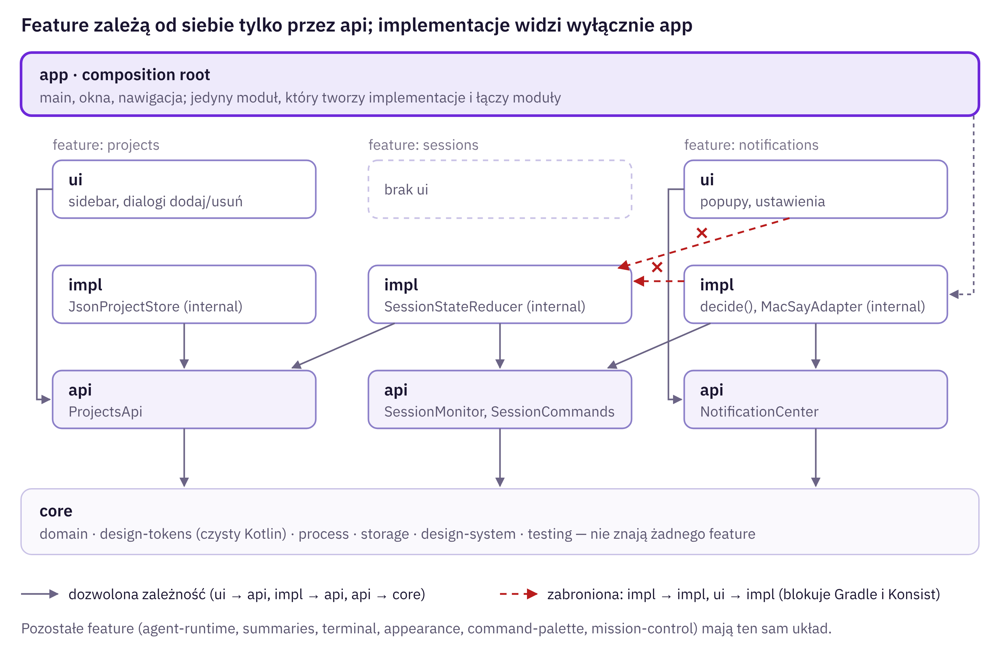
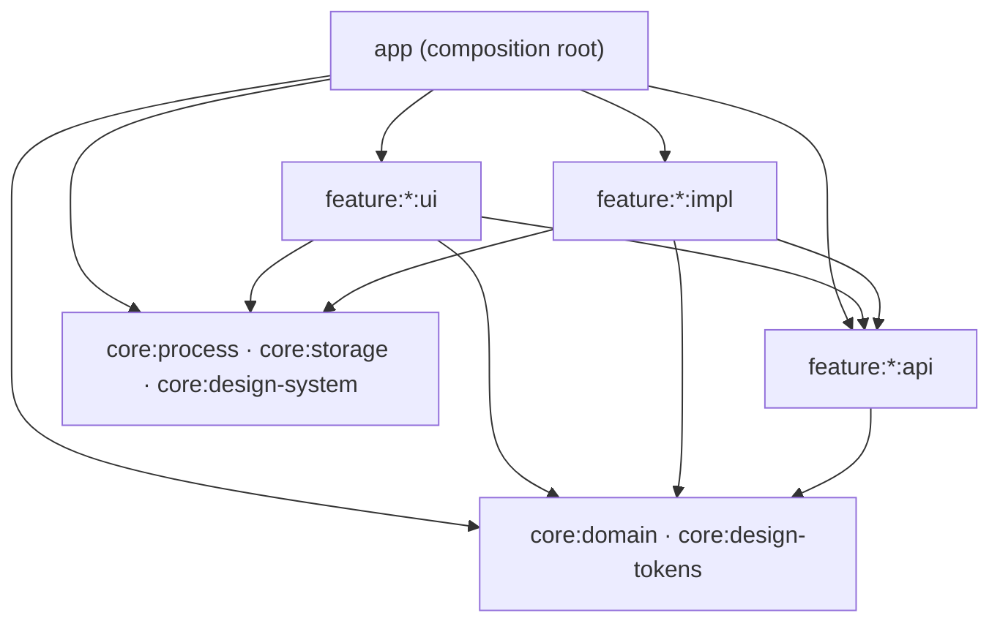
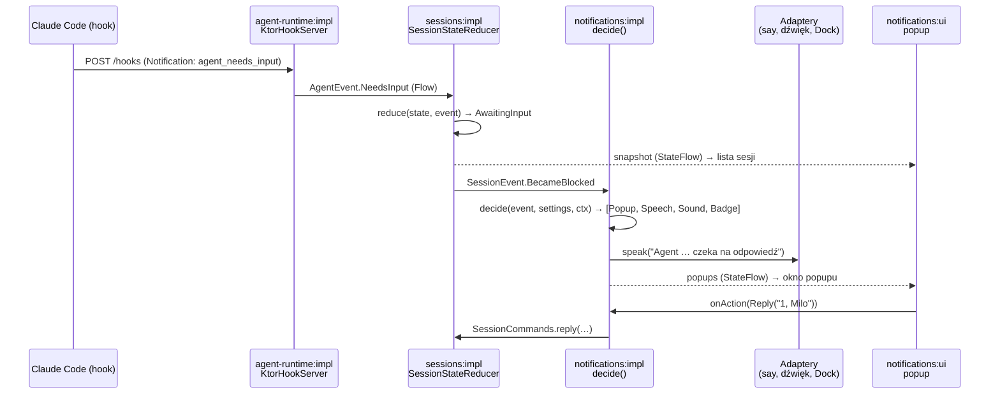

# 11 · Koncepcja techniczna

Dokument opisuje, jak zbudować Quayside tak, żeby spełnić [wymagania inżynierskie](10-wymagania-inzynierskie.md): jasne moduły, hermetyczność, jasne interfejsy i izolację zmian. Funkcje produktu opisują pliki [02](02-wymagania.md)–[08](08-wyglad.md), a ogólny przepływ danych [03-architektura.md](03-architektura.md).

## 1. Styl architektury

| Zasada | Co to znaczy w praktyce |
| --- | --- |
| **Modularny monolit** | Jedna aplikacja desktopowa, ale kod podzielony na niezależne moduły Gradle z wymuszonymi granicami |
| **Porty i adaptery (heksagonalna)** | Logika rozmawia z interfejsami (portami). Świat zewnętrzny (Claude Code CLI, pliki, HTTP, `say`, PTY) jest za adapterami, które można podmienić |
| **Funkcyjny rdzeń, imperatywna powłoka** | Decyzje (stan sesji, reguły powiadomień, parsowanie, walidacja) to czyste funkcje. IO dzieje się na brzegach |
| **Jednokierunkowy przepływ danych (MVI) w UI** | Ekran = funkcja stanu. Zdarzenia użytkownika → `Intent` → ViewModel → nowy `UiState`. Composable są bezstanowe |
| **Jeden composition root** | Tylko moduł `app` składa całość. Żadnych kontenerów DI z refleksją; ręczne wstrzykiwanie przez konstruktory i fabryki modułów |

## 2. Mapa modułów



### Moduły wspólne (`core`)

| Moduł | Zawartość | Zależności |
| --- | --- | --- |
| `core:domain` | Typy bazowe: `ProjectId`, `SessionId`, `Outcome`, `Clock`, `Logger`, `Dispatchers`, `ShellCommand`. Czysty Kotlin | brak (tylko coroutines-core) |
| `core:process` | `ProcessRunner`: uruchamianie procesów przez login shell, timeouty, ucinanie wyjścia | `core:domain` |
| `core:storage` | `JsonStore<T>`: atomowy zapis plików konfiguracji, wersja schematu, migracje | `core:domain` |
| `core:design-tokens` | Model tokenów wyglądu (`ColorTokens`, `TypographySpec`), bez Compose | `core:domain` |
| `core:design-system` | Komponenty Compose (przyciski, wiersze listy, pasek trybu, popup), `AmTheme` z `CompositionLocal` | `core:design-tokens` |
| `core:testing` | Wspólne narzędzia testowe: `TestClock`, `TestDispatchers`, buildery danych, asercje | `core:domain` |

### Feature (każdy jako `api` / `impl` / `ui`)

| Feature | `api` (kontrakt) | `impl` (implementacja i adaptery) | `ui` |
| --- | --- | --- | --- |
| `agent-runtime` | `AgentRuntime`, `AgentEventSource`, `HookInstaller` | `ClaudeCliAdapter`, parser `agents --json`, `KtorHookServer`, `SettingsJsonHookInstaller` | – |
| `projects` | `ProjectsApi` | `JsonProjectStore`, `DirectoryInspector` (git, `CLAUDE.md`, hooki) | sidebar, dialogi dodaj/usuń |
| `sessions` | `SessionMonitor`, `SessionCommands` | `SessionStateReducer` (czysty), pętla pollingu, scalanie z hookami | – |
| `summaries` | `Summarizer` | z `last_assistant_message`; opcjonalnie `claude -p --model haiku` | – |
| `notifications` | `NotificationCenter`, `NotificationSettingsRepo` | `NotificationPolicy` (czysta), `MacSayAdapter`, `SoundAdapter`, `DockBadgeAdapter` | okna popupów, ekran ustawień |
| `terminal` | `TerminalApi`, `TerminalSession` | JediTerm + pty4j, profile powłoki, OSC 133 | karty, panele, szukanie |
| `appearance` | `AppearanceApi`, katalog schematów i typografii | `JsonThemeStore`, wbudowany katalog, przełączanie dzień/noc | ekran Wygląd |
| `command-palette` | `CommandRegistry`, `Command`, `CommandMatcher` (czyste wyszukiwanie) | rejestr komend (w pamięci, bez duplikatów id i skrótów) | paleta ⌘K |
| `mission-control` | – | – | główny ekran, składa UI innych feature |

Moduł `app` zawiera tylko `main`, composition root, okna i nawigację.

## 3. Reguły zależności



1. `ui` → `api` (dowolnego feature), `core:*`. **Nigdy** `impl`.
2. `impl` → własne `api`, `api` innych feature, `core:*`. **Nigdy** inne `impl` ani `ui`.
3. `api` → tylko `core:domain` i `core:design-tokens`.
4. `core:*` → nic z feature.
5. `app` → wszystko. Jedyny moduł, który widzi `impl`.

**Wymuszanie:**

- **Gradle (`build-logic`)**: convention plugin `am.feature.impl` odrzuca build, jeśli moduł `impl` deklaruje zależność od innego `:impl` lub `:ui`. Moduły `impl` są dołączane wyłącznie w `app`.
- **Kotlin `internal`**: w `impl` publiczna jest tylko fabryka modułu.
- **Konsist (testy architektury)**: reguły jak wyżej plus zakazane importy (`java.io`, `java.net`, `ProcessBuilder`, `androidx.compose` w `core:domain` i `*:api`), nazewnictwo (`*Adapter` tylko w `impl`), brak `object` ze stanem.

Jedyny świadomy wyjątek: `terminal:api` może używać `javax.swing.JComponent` (typ JDK, nie biblioteki), bo terminal jest z natury widgetem. JediTerm nadal nie wycieka poza `terminal:impl`.

## 4. Kontrakty modułów (szkic API)

```kotlin
// core:domain
@JvmInline value class ProjectId(val value: String)
@JvmInline value class SessionId(val value: String)          // krótkie ID supervisora, np. "7c5dcf5d"

sealed interface Outcome<out T, out E> {
    data class Ok<T>(val value: T) : Outcome<T, Nothing>
    data class Err<E>(val error: E) : Outcome<Nothing, E>
}

fun interface Clock { fun now(): Instant }
data class ShellCommand(val argv: List<String>, val workDir: Path, val env: Map<String, String> = emptyMap())
```

```kotlin
// agent-runtime:api — port do środowiska, które uruchamia agentów (dziś: supervisor Claude Code)
// Każda metoda suspend: dowolny dispatcher, nie blokuje wątku, nie rzuca poza CancellationException.
@JvmInline value class ConversationId(val value: String)   // UUID rozmowy (hook session_id); łączy hooki z pollingiem

interface AgentRuntime {
    suspend fun listSessions(under: Path? = null): Outcome<List<RuntimeSession>, RuntimeError>  // cwd == under lub poniżej
    suspend fun start(spec: StartSpec): Outcome<SessionId, RuntimeError>    // claude --bg
    suspend fun stop(id: SessionId): Outcome<Unit, RuntimeError>
    suspend fun respawn(id: SessionId): Outcome<Unit, RuntimeError>
    suspend fun remove(id: SessionId): Outcome<Unit, RuntimeError>          // nigdy nie usuwa plików projektu
    suspend fun recentOutput(id: SessionId): Outcome<String, RuntimeError>  // ogon claude logs, już przycięty
    fun attachCommand(id: SessionId): ShellCommand          // czysta funkcja; uruchamiane przez terminal w PTY
    suspend fun health(): RuntimeHealth                     // nigdy nie zawodzi: problemy są w RuntimeHealth
}

data class RuntimeSession(
    val id: SessionId, val conversationId: ConversationId?, val name: String, val cwd: Path,
    val phase: RuntimePhase, val waitingFor: WaitingFor?, val startedAt: Instant, val pid: Long?,
)
enum class RuntimePhase { WORKING, BLOCKED, DONE, FAILED, STOPPED }
sealed interface WaitingFor { data object Permission : WaitingFor; data object Input : WaitingFor; data class Other(val raw: String) : WaitingFor }

data class StartSpec(                                       // FR-S3; toString ukrywa prompt (ENG-C8)
    val cwd: Path, val prompt: String, val name: String? = null, val agent: String? = null,
    val model: String? = null, val permissionMode: PermissionMode? = null,
)
enum class PermissionMode { DEFAULT, ACCEPT_EDITS, PLAN, BYPASS_PERMISSIONS }

data class RuntimeHealth(val version: String?, val agentViewEnabled: Boolean, val supervisorRunning: Boolean,
                         val problems: List<RuntimeError>) { val isReady: Boolean /* problems.isEmpty() */ }
object RuntimeRequirements { const val MIN_CLAUDE_VERSION = "2.1.139" }   // NFR-9, docs/compat.md

sealed interface RuntimeError {
    data object NotInstalled : RuntimeError
    data class UnsupportedVersion(val found: String, val required: String) : RuntimeError
    data object AgentViewDisabled : RuntimeError
    data class UnknownSession(val id: SessionId) : RuntimeError
    data class CommandFailed(val exitCode: Int, val stderrTail: String) : RuntimeError
    data class Unparseable(val detail: String) : RuntimeError   // stała kategoria, nigdy treść wejścia
    data object Timeout : RuntimeError
}

interface AgentEventSource { val events: Flow<AgentEvent> }  // zdarzenia z hooków HTTP; gorący, bez replay
data class EventMeta(val conversationId: ConversationId, val cwd: Path, val at: Instant)
sealed interface AgentEvent {                                 // question/lastMessage: tylko DEBUG, toString je ukrywa
    val meta: EventMeta
    data class NeedsInput(override val meta: EventMeta, val question: String?) : AgentEvent
    data class PermissionRequested(override val meta: EventMeta, val tool: String?) : AgentEvent
    data class TurnEnded(override val meta: EventMeta, val lastMessage: String?) : AgentEvent
    data class Failed(override val meta: EventMeta, val kind: String) : AgentEvent
    data class SessionEnded(override val meta: EventMeta, val reason: String) : AgentEvent
}

interface HookInstaller {
    suspend fun status(scope: HookScope): HookStatus
    suspend fun install(scope: HookScope): Outcome<BackupRef, HookError>   // zawsze z kopią zapasową; idempotentne
    suspend fun uninstall(scope: HookScope, backup: BackupRef?): Outcome<Unit, HookError>  // tylko nasze hooki; z backup: przywraca kopię
}
sealed interface HookScope {
    data object Global : HookScope                       // ~/.claude/settings.json
    data class Project(val dir: Path) : HookScope        // <dir>/.claude/settings.local.json
}
enum class HookKind { NOTIFICATION, STOP, STOP_FAILURE, SESSION_START, SESSION_END }
sealed interface HookStatus {
    data object NotInstalled : HookStatus
    data object Installed : HookStatus
    data class Partial(val missing: Set<HookKind>) : HookStatus
    data class Unreadable(val reason: String) : HookStatus        // stała kategoria
}
@JvmInline value class BackupRef(val value: String)             // nieprzezroczysty uchwyt kopii (hooks-backup/)
sealed interface HookError {                                     // reason: stała kategoria, nigdy treść pliku
    data class SettingsUnreadable(val file: Path, val reason: String) : HookError
    data class WriteFailed(val file: Path, val reason: String) : HookError
    data class BackupNotFound(val ref: BackupRef) : HookError
}
```

```kotlin
// projects:api
interface ProjectsApi {
    val projects: StateFlow<List<Project>>
    val storageIssue: StateFlow<StorageIssue?>                      // problem z projects.json przy starcie, null = brak
    suspend fun add(dir: Path, displayName: String? = null): Outcome<Project, ProjectError>
    suspend fun remove(id: ProjectId): Outcome<Unit, ProjectError> // nigdy nie usuwa plików z dysku
    suspend fun rename(id: ProjectId, displayName: String): Outcome<Unit, ProjectError>
}
// RECOVERED_FROM_BROKEN_FILE: plik odłożony jako .broken, komendy działają (komunikat w UI, §8);
// READ_FAILED / NEWER_SCHEMA: komendy zwracają StorageFailed, plik nie jest nadpisywany
enum class StorageIssue { RECOVERED_FROM_BROKEN_FILE, READ_FAILED, NEWER_SCHEMA }
// inspekcja przed dodaniem osobno (ENG-I2); nieistniejący katalog to błąd, nie pole raportu
interface ProjectInspector {
    suspend fun inspect(dir: Path): Outcome<DirectoryReport, ProjectError> // git, CLAUDE.md, liczba sesji, hooki
}
// ProjectInputRules: czyste reguły (normalizacja składniowa ścieżki, nazwa ≤ 80 code pointów) wspólne dla impl i fake'ów
// Project.dir i DirectoryReport.dir to ścieżka rzeczywista (toRealPath()), porównywalna z cwd sesji
```

```kotlin
// sessions:api — odczyt i komendy rozdzielone (ENG-I2)
interface SessionMonitor {
    val snapshot: StateFlow<SessionsSnapshot>
    val events: Flow<SessionEvent>                 // przejścia stanów, konsumowane m.in. przez powiadomienia
    suspend fun recentOutput(id: SessionId): Outcome<RecentOutput, SessionError>  // ogon wyjścia (`claude logs`), odczyt na żądanie (AM-411)
}
sealed interface SessionState {
    data object Working : SessionState
    data class AwaitingInput(val question: String?) : SessionState
    data class AwaitingPermission(val tool: String?) : SessionState
    data object Done : SessionState
    data class Failed(val reason: String) : SessionState
    data object Stopped : SessionState
}
sealed interface SessionEvent {
    val session: Session
    data class BecameBlocked(override val session: Session) : SessionEvent
    data class TurnFinished(override val session: Session) : SessionEvent
    data class Failed(override val session: Session) : SessionEvent
    data class PullRequestReady(override val session: Session) : SessionEvent
    data class RunningLong(override val session: Session, val duration: Duration) : SessionEvent
}
interface SessionCommands {
    suspend fun start(project: ProjectId, spec: NewSessionSpec): Outcome<SessionId, SessionError>
    suspend fun stop(id: SessionId): Outcome<Unit, SessionError>
    suspend fun stopAllIn(project: ProjectId): Outcome<Int, SessionError>
    suspend fun respawn(id: SessionId): Outcome<Unit, SessionError>
    suspend fun remove(id: SessionId): Outcome<Unit, SessionError>
    suspend fun reply(id: SessionId, text: String): Outcome<Unit, SessionError>  // AM-506; strategia: otwarta kwestia (09)
}
```

```kotlin
// notifications:api
interface NotificationCenter {
    val popups: StateFlow<List<PopupModel>>        // renderowane przez notifications:ui
    suspend fun onAction(popup: PopupId, action: PopupAction)
}
interface NotificationSettingsRepo {
    val settings: StateFlow<NotificationSettings>
    suspend fun update(change: (NotificationSettings) -> NotificationSettings)
}

// notifications:impl (internal) — czysty rdzeń decyzji
internal fun decide(event: SessionEvent, settings: NotificationSettings, ctx: DeliveryContext): List<Delivery>
internal interface SpeechPort { suspend fun speak(text: String, voice: VoiceId, rate: Int) }  // adapter: MacSayAdapter
```

```kotlin
// terminal:api (AM-502, find w AM-504; profile i settings dochodzą w AM-508)
interface TerminalApi : AutoCloseable {
    suspend fun openShell(dir: Path): Outcome<TerminalSession, TerminalError>
    suspend fun openCommand(command: ShellCommand): Outcome<TerminalSession, TerminalError>  // np. attachCommand z AgentRuntime
}
interface TerminalSession : AutoCloseable {
    val id: TerminalId; val exitCode: StateFlow<Int?>
    fun component(): javax.swing.JComponent   // osadzany w Compose przez SwingPanel
    val search: TerminalSearch                // FR-T3, działa także po zakończeniu procesu
    suspend fun send(text: String): Outcome<Unit, TerminalError>
}
sealed interface TerminalError { WorkDirMissing; StartFailed; Closed }

interface TerminalSearch {
    suspend fun find(query: SearchQuery): Outcome<SearchResult, SearchError>   // podświetla wszystko, wybiera najnowsze
    suspend fun step(direction: SearchDirection): Outcome<SearchResult, SearchError>  // UP = starsze, DOWN = nowsze, cyklicznie
    suspend fun clear()
}
data class SearchQuery(val text: String, val matchCase: Boolean = false, val regex: Boolean = false)
data class SearchMatch(val row: Int, val start: Int, val end: Int)   // wiersz 0 = najstarszy wiersz migawki
data class SearchResult(val count: Int, val current: Int?, val limited: Boolean)
sealed interface SearchError { InvalidPattern; Closed }
object ScrollbackMatcher { const val MAX_MATCHES = 10_000; fun find(rows: List<String>, query: SearchQuery): Outcome<List<SearchMatch>, SearchError> }  // czysta reguła w `api`, wspólna dla impl i fake'a
```

```kotlin
// appearance:api (typy z core:design-tokens, bez Compose)
interface AppearanceApi {
    val theme: StateFlow<ResolvedTheme>           // aktualny schemat + typografia + skala
    val catalog: ThemeCatalog                     // 9 schematów, 8 typografii, własne
    suspend fun select(scheme: SchemeId? = null, typography: TypographyId? = null)
    suspend fun update(change: (AppearanceSettings) -> AppearanceSettings)
}

// command-palette:api (komendy składa `app`, ADR 0011; typy skrótu bez Compose, ENG-I8)
interface CommandRegistry {
    fun register(provider: CommandProvider): AutoCloseable
    val commands: StateFlow<List<Command>>
}
interface CommandProvider { val commands: StateFlow<List<Command>> }
data class Command(val id: CommandId, val title: String, val group: CommandGroup,
                   val keywords: List<String> = emptyList(), val shortcut: Shortcut? = null,
                   val run: suspend () -> Unit)
data class Shortcut(val chords: List<KeyChord>)          // 1 akord (⌘K) albo 2 (g p)
data class KeyChord(val key: ChordKey, val modifiers: Set<KeyModifier> = emptySet())
object CommandMatcher { fun search(query: String, commands: List<Command>): List<Command> }  // czyste wyszukiwanie w `api`
```

## 5. Przepływ danych: „agent zadał pytanie”



Każdy krok po stronie aplikacji jest testowalny w izolacji: parser hooka (unit), reducer (unit, tablicowo), `decide` (unit, tablicowo), adaptery (integracyjnie), całość (funkcjonalnie z fake'ami).

Polling `AgentRuntime.listSessions()` co 2–3 s trafia do tego samego reducera jako wejście `RuntimeSnapshot` i jest **źródłem prawdy**: koryguje stan, jeśli hook zaginął. Hooki niosą `conversationId` (UUID rozmowy), a lista sesji ma oba identyfikatory, więc reducer łączy je po `conversationId`.

## 6. Współbieżność

| Element | Dispatcher / zakres |
| --- | --- |
| Stan UI, ViewModel | `Dispatchers.Main` (Swing EDT w Compose Desktop) |
| Procesy (`claude`, `say`, `git`) | `io`, z timeoutem per wywołanie (domyślnie 10 s, `start` 30 s) |
| Pętla pollingu | `CoroutineScope` modułu `sessions`, `delay(pollInterval)`, wynik przez `conflate()` |
| Serwer hooków | Ktor CIO na własnej puli; zdarzenia do `MutableSharedFlow(extraBufferCapacity = 64)` |
| Zapisy konfiguracji | serializowane przez `Mutex` w `JsonStore` |

Dispatchery i zakresy są wstrzykiwane (`AppDispatchers`), więc testy działają na wirtualnym czasie (`runTest`, `StandardTestDispatcher`).

## 7. Obsługa błędów

- Granica modułu: wyłącznie `Outcome<T, E>` z typowanymi błędami (`RuntimeError`, `ProjectError`, `SessionError`, `HookError`).
- Adapter łapie wyjątki (`IOException`, timeout procesu, błąd JSON) i mapuje je na błąd domenowy. Wyjątek, który przeciekł, to bug.
- UI mapuje błędy na komunikaty: baner „Claude Code nie znaleziony / za stara wersja / Agent View wyłączony” z akcją naprawczą.
- Polling z błędem nie czyści listy: zostaje ostatni znany stan z oznaczeniem „nieaktualne od …”.

## 8. Persystencja i konfiguracja

| Plik w `~/Library/Application Support/Quayside/` | Właściciel (moduł) |
| --- | --- |
| `projects.json` | `projects:impl` |
| `notifications.json` | `notifications:impl` |
| `terminal.json` | `terminal:impl` |
| `theme.json` | `appearance:impl` |
| `hooks-backup/*.json` | `agent-runtime:impl` |

- Każdy plik ma **jednego właściciela**. Inne moduły nie czytają cudzych plików.
- `JsonStore<T>` z `core:storage`: zapis do pliku tymczasowego i `ATOMIC_MOVE`, pole `schemaVersion`, lista migracji `vN → vN+1`. Uszkodzony plik jest odkładany jako `*.broken` i zastępowany domyślnymi wartościami z komunikatem w UI.
- Token hooków przechowywany w Keychain macOS (adapter w `agent-runtime:impl`), nie w plikach.

## 9. Composition root

```kotlin
// app/src/main/kotlin/Main.kt — jedyne miejsce, które zna implementacje
fun main() = application {
    val core = CoreDeps(clock = SystemClock, dispatchers = AppDispatchers.Default, logger = Slf4jLogger("am"),
                        process = LoginShellProcessRunner(), storage = JsonStorage(appSupportDir()))

    val runtime       = agentRuntimeModule(core, RuntimeConfig(minVersion = "2.1.139", hookPort = 47321))
    val projects      = projectsModule(core)
    val summaries     = summariesModule(core, runtime.agentRuntime)
    val sessions      = sessionsModule(core, runtime, projects, summaries)
    val notifications = notificationsModule(core, sessions.monitor, sessions.commands)
    val terminal      = terminalModule(core)
    val appearance    = appearanceModule(core)
    val palette       = commandPaletteModule(core)

    QuaysideApp(projects, sessions, notifications, terminal, appearance, palette, runtime.hookInstaller)
}
```

Każda fabryka `xxxModule(…)` zwraca obiekt z interfejsami `api`, np. `SessionsApi(monitor: SessionMonitor, commands: SessionCommands)`. Klasy implementacji pozostają `internal`.

## 10. Izolacja zmian: gdzie ląduje typowa zmiana

| Zmiana | Dotknięte moduły | Nie zmienia się |
| --- | --- | --- |
| Claude Code zmienia format `agents --json` albo flagi CLI | `agent-runtime:impl` (parser, fixtures) | wszystko inne |
| Przejście z CLI na Agent SDK | nowa implementacja `AgentRuntime` w `agent-runtime:impl` + wpięcie w `app` | `sessions`, `notifications`, UI |
| Nowe zdarzenie hooka (np. `TaskCompleted`) | `agent-runtime` (`api` + `impl`), reducer w `sessions:impl` | `projects`, `terminal`, `appearance` |
| Podmiana `say` na `AVSpeechSynthesizer` (JNA) | adapter w `notifications:impl` | reguły, UI, ustawienia |
| Nowy kanał powiadomień (np. webhook do Slacka) | `notifications` (`api`: typ kanału, `impl`: adapter), `notifications:ui` (przełącznik) | `sessions`, `agent-runtime` |
| Zmiana biblioteki terminala | `terminal:impl` | `terminal:ui` (tylko jeśli zmieni się `component()`), reszta |
| Nowy schemat kolorów lub typografia | katalog w `appearance:impl` (+ font w zasobach) | wszystkie ekrany (czytają tokeny) |
| Nowy ekran lub przeprojektowanie Mission Control | `mission-control:ui`, ewentualnie `core:design-system` | logika i adaptery |
| Zmiana formatu `projects.json` | `projects:impl` (migracja schematu) | wszystko inne |

## 11. Struktura repozytorium

```text
quayside/
├── app/                          # main, composition root, okna, nawigacja
├── build-logic/                  # convention plugins: am.kotlin, am.feature.api|impl|ui, am.quality
├── core/
│   ├── domain/  process/  storage/  design-tokens/  design-system/  testing/
├── feature/
│   ├── agent-runtime/  { api/ impl/ }
│   ├── projects/       { api/ impl/ ui/ }
│   ├── sessions/       { api/ impl/ }
│   ├── summaries/      { api/ impl/ }
│   ├── notifications/  { api/ impl/ ui/ }
│   ├── terminal/       { api/ impl/ ui/ }
│   ├── appearance/     { api/ impl/ ui/ }
│   ├── command-palette/{ api/ impl/ ui/ }
│   └── mission-control/{ ui/ }
├── tests/
│   ├── architecture/             # Konsist
│   ├── functional/               # Compose UI, scenariusze akceptacyjne
│   └── e2e/                      # z prawdziwym Claude Code (tag e2e)
├── docs/                         # ta dokumentacja + docs/adr/
├── gradle/libs.versions.toml     # katalog wersji
├── CLAUDE.md                     # zasady dla agentów (10, sekcja G)
└── settings.gradle.kts
```

Pakiety: `dev.quayside.<feature>.<api|impl|ui>` (pakiet = moduł, łatwe reguły Konsist).

## 12. Narzędzia i biblioteki

| Obszar | Wybór |
| --- | --- |
| Build | Gradle (Kotlin DSL), katalog wersji, convention plugins w `build-logic`, JDK 21 |
| Język i UI | Kotlin 2.x, Compose Multiplatform for Desktop |
| Asynchroniczność | kotlinx.coroutines (`Flow`, `StateFlow`) |
| Serializacja | kotlinx.serialization (JSON) |
| HTTP (hooki) | Ktor server (CIO) |
| Terminal | JediTerm + pty4j |
| Jakość | Spotless + ktlint, detekt, Kover (pokrycie), Konsist (architektura) |
| Testy | JUnit 5, Kotest assertions, Turbine (`Flow`), MockK (oszczędnie, preferowane fake'i), Compose UI test |
| Pakowanie | Compose `packageDmg` / jpackage, podpis Developer ID, notaryzacja (`notarytool`) |
| CI | GitHub Actions na runnerze macOS (Apple Silicon) |

Konkretne wersje ustala `libs.versions.toml` przy starcie projektu (aktualne stabilne).

## 13. Pierwsze ADR

| ADR | Decyzja |
| --- | --- |
| 001 | Kotlin + Compose Desktop zamiast SwiftUI |
| 002 | Supervisor Claude Code przez CLI jako backend agentów; aplikacja nie hostuje procesów |
| 003 | Modularny monolit z podziałem `api` / `impl` / `ui` i jednym composition root |
| 004 | Zdarzenia przez hooki HTTP + polling jako źródło prawdy |
| 005 | Typowane `Outcome` zamiast wyjątków na granicach modułów |
| 006 | Ręczne wstrzykiwanie zależności (bez frameworka DI) |
| 007 | Strategia testów: piramida + testy kontraktowe + testy architektury ([12](12-strategia-testow.md)) |
