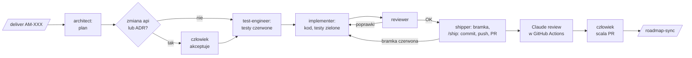

# 14. Agent Claude Code — wdrażanie i utrzymanie

> Jak działa agent, który buduje Agent Managera według [ROADMAP.md](ROADMAP.md) i później go utrzymuje. Proces i etapy opisuje [13-plan-wdrozenia.md](13-plan-wdrozenia.md).

## 1. Idea

Agent to nie jeden prompt, tylko zestaw mechanizmów Claude Code zapisanych w repo, więc każdy klon repo ma tego samego agenta:

| Mechanizm | Gdzie | Rola |
| --- | --- | --- |
| `CLAUDE.md` | katalog główny | Złote zasady, mapa dokumentacji, polecenia. Czyta je każda sesja. |
| Agent główny | `.claude/agents/am-lead.md` | Prowadzi pracę, deleguje, pilnuje procesu. Uruchamiany przez `claude --agent am-lead`. |
| Subagenci | `.claude/agents/*.md` | Specjaliści z wąskimi uprawnieniami i własnym kontekstem. |
| Skille | `.claude/skills/*/SKILL.md` | Powtarzalne procedury (`/deliver`, `/ship`, …). |
| Hooki | `.claude/settings.json` + `.claude/hooks/` | Twarde reguły, których model nie może pominąć: blokady, formatowanie, bramka jakości, kontekst sesji, powiadomienia. |
| Uprawnienia | `.claude/settings.json` | Co agent robi sam, o co pyta, czego nie może nigdy. |
| GitHub Actions | `.github/workflows/` | Review każdego PR, odpowiedzi na `@claude`, cotygodniowy przegląd zgodności, wydania. |

Zasada podziału: **to, co musi się zdarzyć zawsze, jest hookiem; to, co wymaga oceny, jest skillem lub subagentem.**

## 2. Role

| Agent | Model | Uprawnienia | Co robi |
| --- | --- | --- | --- |
| `am-lead` | opus | może delegować tylko do 7 poniższych | Wybiera zadanie, prowadzi cykl `/deliver`, rozmawia z człowiekiem. Nie pisze kodu, nie uruchamia bramki i nie commituje; to robią subagenci na Sonnecie. |
| `architect` | opus | czyta wszystko, pisze `docs/plans/`, `docs/adr/` | Plan zadania: moduły, zmiany w `api`, testy, ryzyka. Szkic ADR przy nowej decyzji. |
| `test-engineer` | sonnet | pisze tylko w katalogach testów | Testy przed kodem: jednostkowe, kontraktowe, funkcjonalne. Testy mają najpierw nie przechodzić. |
| `implementer` | sonnet | pisze tylko w modułach z planu | Kod, aż testy przejdą. Maks. 3 rundy naprawy, potem eskalacja do `am-lead`. |
| `reviewer` | opus | tylko odczyt, pamięć projektu | Review wg checklisty (granice modułów, testy, `Outcome`, DoD). Zwraca `WERDYKT: OK` albo listę poprawek. Zapamiętuje powtarzające się błędy. |
| `shipper` | sonnet | bramka, roadmapa, CHANGELOG, commity, push, PR | Uruchamia `./gradlew check`, aktualizuje dokumentację zadania i wysyła PR przez `/ship`. Czerwonej bramki nie naprawia, tylko zwraca błędy do `am-lead`. |
| `release-manager` | sonnet | CHANGELOG, wersja, gałąź `release/*` | Przygotowuje wydanie. Taguje tylko na wyraźne polecenie człowieka. |
| `maintainer` | sonnet | czyta, tworzy issue | Zgodność z nowymi wersjami Claude Code, przegląd PR Dependabota, triage zgłoszeń. |

Subagenci nie widzą rozmowy `am-lead`, dostają tylko zlecenie. Dzięki temu kontekst lidera zostaje czysty, a reviewer ocenia kod bez wiedzy, „co autor miał na myśli”.

## 3. Cykl dostarczenia zadania



Kroki `/deliver`:

0. Kontekst: gałąź, stan roadmapy, otwarte PR (wstrzykiwane dynamicznie).
1. Wybór zadania: pierwsze `[ ]` z etapu, którego zależności są `[x]`, lub ID z argumentu.
2. Gałąź `feat/AM-XXX-opis`, status `[~]` w roadmapie.
3. Plan od `architect` w `docs/plans/AM-XXX.md`.
4. Punkt kontrolny: zmiana `api` innego feature lub nowy ADR → pytanie do człowieka.
5. Testy od `test-engineer` (muszą nie przechodzić).
6. Implementacja od `implementer` (sam doprowadza `./gradlew check` do zielonego).
7. Kontrola zakresu przez `am-lead` (`git diff --stat`), bez uruchamiania bramki.
8. Review od `reviewer`, maks. 2 rundy poprawek.
9. `shipper`: `./gradlew check`, roadmapa i CHANGELOG, `/ship`. Czerwona bramka wraca do `implementer`.

Podział modeli: planowanie i decyzje na Opusie (`am-lead`, `architect`, `reviewer`), wykonanie na Sonnecie (`test-engineer`, `implementer`, `shipper`).

## 4. Skille

| Skill | Kto wywołuje | Opis |
| --- | --- | --- |
| `/deliver [AM-XXX]` | człowiek, `am-lead` | Pełny cykl zadania z roadmapy (sekcja 3). |
| `/ship` | człowiek, `am-lead` | Bramka, commity Conventional Commits, push gałęzi, PR z polskim opisem wg szablonu. Aktualizuje istniejący PR. |
| `/new-module <feature>` | `architect`, `implementer` | Szkielet `api`/`impl`/`ui` z konwencją, fabryką, kontraktem i fake'iem. |
| `/adr <tytuł>` | `architect` | Nowy ADR z kolejnym numerem, status „proponowana”. |
| `/review-pr <nr> [--comment]` | człowiek, GitHub Actions | Review PR wg checklisty, opcjonalnie jako komentarz. |
| `/release prepare\|tag` | tylko człowiek | Przygotowanie wydania, potem tag. Model nie może go wywołać sam. |
| `/compat-check` | GitHub Actions co tydzień, człowiek | Porównuje changelog Claude Code z `docs/compat.md`, zakłada issue `compat`. |
| `/triage <opis>` | człowiek | Zgłoszenie → issue z typem, modułem, priorytetem. |
| `/roadmap-sync` | człowiek, `am-lead` po scaleniu | Roadmapa ↔ GitHub: etykiety, milestone'y, issue, statusy (`scripts/roadmap_sync.py`). |

## 5. Hooki

| Zdarzenie | Skrypt | Działanie |
| --- | --- | --- |
| `SessionStart` | `session-context.sh` | Dokleja do kontekstu: gałąź, niezatwierdzone pliki, ostatnie commity, zadania `[~]` i następne `[ ]`, otwarte PR. |
| `PreToolUse` (Bash) | `guard-bash.sh` | **Blokuje:** force push (wyjątek: `git push --force-with-lease` bieżącej gałęzi `feat/*`, `fix/*`, `chore/*`, `docs/*` po rebase), push do `main`/`master`, push z gałęzi `main`, `--no-verify`, `gh pr merge` i merge przez API, `rm -rf` na `/`, `~`, `..`, edycję konfiguracji agenta z powłoki. **Pyta:** `git reset --hard`, `git clean`. |
| `PreToolUse` (Edit/Write) | `guard-files.sh` | **Blokuje:** sekrety (`.env`, `*.p12`), konfigurację agenta, edycję przyjętych ADR. **Pyta:** workflowy GitHub, pliki poza repo. |
| `PostToolUse` (Edit/Write) | `format-kotlin.sh` | Formatuje zmieniony plik Kotlin (`ktlint --format`), asynchronicznie. |
| `Stop` | `quality-gate.sh` | Gdy zmieniono Kotlin, uruchamia `./gradlew quickCheck`. Przy błędzie nie pozwala zakończyć tury i oddaje skrót błędów. Po 3 rundach przepuszcza z ostrzeżeniem, żeby nie zapętlić agenta. |
| `Notification` | `notify.sh` | Powiadomienie macOS i głos (`say -v Zosia`), gdy agent czeka na zgodę lub odpowiedź. `AM_VOICE=0` wycisza głos. |

Konfigurację agenta zmienia tylko człowiek. Świadomą zmianę przez agenta odblokowuje `AM_ALLOW_AGENT_CONFIG_EDIT=1` w środowisku sesji.

## 6. Uprawnienia

- **Bez pytania:** Gradle, odczyt i lokalne operacje git, commit, push gałęzi, `gh issue/pr create|view|edit|comment`, skrypty z `scripts/`.
- **Z pytaniem:** tagi, push tagów, `gh release`, surowe `gh api`.
- **Nigdy:** force push (poza `--force-with-lease` własnej gałęzi zadania), push do `main`, `gh pr merge`, usuwanie repo, czytanie sekretów, edycja `.claude/settings.json` i hooków.

Reguły `deny` w uprawnieniach i blokady w hookach się dublują celowo: uprawnienia są pierwszą linią, hooki łapią warianty, których wzorce nie obejmą (np. `git push origin HEAD:main`).

## 7. Automatyzacja na GitHubie

| Workflow | Kiedy | Co robi |
| --- | --- | --- |
| `ci.yml` | każdy PR i push do `main` | Lint dokumentacji, poprawność konfiguracji agenta, `./gradlew check` na macOS (od AM-101). |
| `claude-review.yml` | PR otwarty lub zaktualizowany (bez szkiców) | `/review-pr <nr> --comment`, tylko komentarz z werdyktem. |
| `claude.yml` | `@claude` w issue lub PR | Odpowiada, poprawia kod w PR, zakłada PR z issue. |
| `maintenance.yml` | poniedziałki 06:17 UTC, ręcznie | `/compat-check` → issue `compat`. |
| `release.yml` | tag `v*` | Buduje `.dmg`, opcjonalnie podpisuje i notaryzuje, publikuje release z notatkami z CHANGELOG. |
| Dependabot | co tydzień / miesiąc | PR z aktualizacjami Gradle i akcji; `maintainer` je przegląda. |

## 8. Punkty kontrolne człowieka

Agent zatrzymuje się i czeka na człowieka, gdy:

1. Plan zmienia `api` innego feature albo wymaga nowego ADR.
2. Implementer nie przeszedł testów po 3 rundach.
3. Reviewer po 2 rundach nadal zgłasza poprawki.
4. PR jest gotowy — **scala zawsze człowiek** (squash merge).
5. Wydanie: `/release tag` uruchamia tylko człowiek.
6. Issue `compat` z priorytetem P1 (zmiana w Claude Code psuje aplikację).

## 9. Jak używać

```bash
# Codzienna praca: następne zadanie z roadmapy
claude --agent am-lead
> /deliver

# Konkretne zadanie
> /deliver AM-203

# Zgłoszenie błędu
> /triage popup nie znika po zatwierdzeniu uprawnienia

# Po scaleniu PR
> /roadmap-sync

# Wydanie (tylko człowiek)
> /release prepare
> /release tag

# W tle, z podglądem w Agent View (lub w samym Agent Managerze po M4)
claude --bg --agent am-lead "/deliver AM-204"
```

## 10. Rozbudowa agenta

- **Nowa reguła, która musi działać zawsze** → hook w `.claude/hooks/` + wpis w `settings.json`. Przetestuj go symulowanym wejściem JSON (przykłady w komentarzach skryptów).
- **Nowa procedura** → skill w `.claude/skills/<nazwa>/SKILL.md`. Opis (`description`) decyduje, kiedy model go użyje.
- **Nowa specjalizacja** → subagent w `.claude/agents/` i dopisanie go do `Agent(...)` w `am-lead.md`.
- **Wniosek z błędu agenta** → jedna linia w sekcji „Lekcje” w `CLAUDE.md`.
- Każda zmiana konfiguracji agenta idzie osobnym PR `chore(agent): …`, scalanym przez człowieka.
